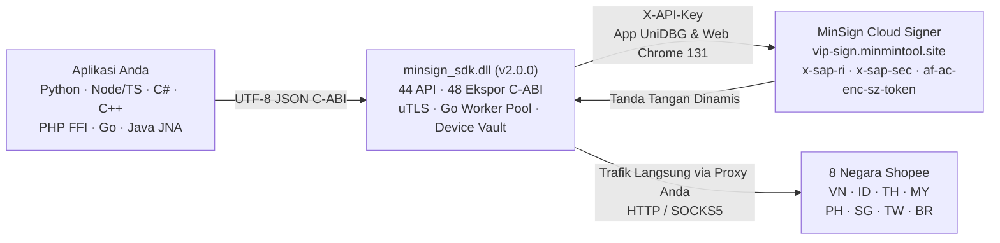

🌐 **Bahasa:** [English](README.md) | [Tiếng Việt](README.vi.md) | [Bahasa Indonesia](README.id.md) | [ภาษาไทย](README.th.md) | [简体中文](README.zh.md)

# ShopeeAPI — MinSign Native Universal SDK (`minsign_sdk.dll` v2.0.0)

[](./CHANGELOG.md)
[](./docs/QUICKSTART_BY_LANGUAGE.md)
[](#8-wilayah-shopee-yang-didukung)
[](#arsitektur-dual-signing)
[](https://vip-sign.minmintool.site)

**Satu library native Windows x64 C-ABI (`minsign_sdk.dll`) — 44 API Shopee & Shopee Affiliate siap produksi, 7 wrapper bahasa resmi, 8 wilayah Shopee, dan Sistem Dual Signing (App Mobile UniDBG + Web Chrome 131).**

Tanpa browser automation, tanpa emulator Android, dan tanpa repot memelihara skrip anti-bot. Bangun scraper produk Shopee berkecepatan tinggi, bot Affiliate komisi tinggi, pipeline Shopee Live & Shopee Video, serta pencarian produk via gambar langsung dari **Python, Node.js/TypeScript, C#, C++, PHP 8+ FFI, Go, atau Java JNA** hanya dengan satu DLL yang dilengkapi `uTLS` native, sticky Android device vault (`devices_vault.json`), dan Go worker pool multi-thread.

> 📚 **Dokumentasi:** [Referensi JSON 44 API (EN)](./docs/API_REFERENCE.md) · [Quickstart 7 Bahasa (EN)](./docs/QUICKSTART_BY_LANGUAGE.md) · [5 Playbook Otomasi (EN)](./docs/USE_CASES_AND_PLAYBOOKS.md) · [Changelog](./CHANGELOG.md)

---

## Arsitektur Dual Signing

Seluruh trafik HTTP/WebSocket ke Shopee berjalan **langsung dari mesin Anda melalui proxy milik Anda sendiri** menggunakan fingerprint `uTLS` (Android OkHttp4 & Chrome 131). MinSign Cloud hanya menerbitkan header tanda tangan keamanan dinamis secara real-time.



---

## Apa yang Bisa Anda Bangun dengan v2.0.0?

<table>
  <tr>
    <td width="50%" valign="top">
      <h3>1. Intelijen Produk &amp; Batch Scraping</h3>
      <ul>
        <li><strong>Ambil Detail Massal Paralel (<code>batch_get_product_details</code>)</strong> — Go worker pool dengan rotasi proxy &amp; cookie otomatis sambil mempertahankan urutan input.</li>
        <li><strong>Parser URL Universal (<code>resolve_shopee_url</code>)</strong> — Parsing URL produk, toko, video, live, dan shortlink (<code>shp.ee</code> / <code>s.shopee.*</code>) di 8 negara.</li>
        <li><strong>Ulasan, Flash Sale &amp; Rekomendasi</strong> — Ambil ulasan pembeli beserta foto/video (<code>get_product_ratings</code>), slot Flash Sale, rekomendasi produk, dan saran kata kunci.</li>
      </ul>
    </td>
    <td width="50%" valign="top">
      <h3>2. Pertumbuhan Affiliate &amp; Konversi Link</h3>
      <ul>
        <li><strong>Berburu Penawaran Komisi Tinggi (<code>get_affiliate_offer_list</code>)</strong> — Query <code>affiliate.shopee.*</code> dengan Web Chrome 131 Signer untuk komisi &amp; komisi ekstra penjual.</li>
        <li><strong>Laporan Komisi (<code>get_affiliate_commission_report</code>)</strong> — Tarik riwayat konversi dan komisi langsung ke dashboard analitik Anda.</li>
        <li><strong>Konversi Massal Link Affiliate (<code>batch_convert_affiliate_links</code>)</strong> — Ubah link produk biasa atau link <code>aff_id</code> kompetitor menjadi <code>s.shopee.*</code> dengan <code>subId1..5</code>.</li>
      </ul>
    </td>
  </tr>
  <tr>
    <td width="50%" valign="top">
      <h3>3. Shopee Video Studio &amp; View Booster</h3>
      <ul>
        <li><strong>Upload Video Pure-API 4 Langkah (<code>upload_shopee_video</code>)</strong> — Pasang hingga 6 produk keranjang Affiliate, mode Normal/Duet, dan mutasi hash MP4 <code>MD5</code>/<code>SHA-256</code> dalam <code>&lt;10ms</code> tanpa FFmpeg.</li>
        <li><strong>Scraper Video Toko Tanpa Watermark (<code>get_shop_videos</code>)</strong> — Ekspor <code>mp4Url</code> bersih beserta produk keranjang kuning (<code>attachedProducts[]</code>).</li>
        <li><strong>Booster View Multi-Thread (<code>buff_video_batch</code>)</strong> — Streaming byte-range MP4 asli + telemetri <code>c-api-bit</code> berkecepatan tinggi.</li>
      </ul>
    </td>
    <td width="50%" valign="top">
      <h3>4. Shopee Live Viewer &amp; Keranjang Live</h3>
      <ul>
        <li><strong>Scraper Keranjang Live (<code>get_live_bag_items</code>)</strong> — Ambil semua produk yang disematkan di keranjang oranye Live beserta harga diskon Live, stok, dan info Affiliate.</li>
        <li><strong>Inspektor Sesi Live (<code>get_live_session_detail</code>)</strong> — Resolusi URL Live ke <code>sessionId</code>, <code>roomId</code>, jumlah penonton, dan stream FLV/HLS.</li>
        <li><strong>Pool Penonton WebSocket + Protobuf (<code>buff_live_batch</code>)</strong> — Koneksi WS RFC 6455 lewat proxy + heartbeat <code>HB_REQ</code> &amp; pelaporan <code>SZTracker</code>.</li>
      </ul>
    </td>
  </tr>
  <tr>
    <td width="50%" valign="top">
      <h3>5. Pencarian Gambar AI &amp; Sourcing Supplier</h3>
      <ul>
        <li><strong>Pencarian Gambar Pure-HTTP (<code>search_products_by_image</code>)</strong> — Mendukung 5 sumber gambar (file lokal, Base64 clipboard, URL TikTok/1688/Taobao, CDN Shopee, atau link produk).</li>
        <li><strong>Cari Harga Lebih Murah (<code>CheaperOptions</code>)</strong> — Bandingkan supplier termurah tanpa browser maupun emulator.</li>
        <li><strong>Deteksi Objek AI (<code>get_image_bounding_box</code>)</strong> — Deteksi koordinat kotak objek (<code>0</code> cookie, <code>0</code> kredit signing).</li>
      </ul>
    </td>
    <td width="50%" valign="top">
      <h3>6. Dual Signing App + Web &amp; Manajemen Akun</h3>
      <ul>
        <li><strong>Web Chrome 131 Signer (<code>sign_web</code>)</strong> — Signing khusus portal Web/Affiliate menggunakan <code>clientType: "web"</code>.</li>
        <li><strong>Layer-2 Risk Token &amp; Device Vault (<code>get_risk_token</code>)</strong> — Profil Android 14 permanen per akun di <code>devices_vault.json</code> (opsional enkripsi AES-256-GCM) + <code>af-ac-enc-sz-token</code>.</li>
        <li><strong>Cek Cookie, Keranjang &amp; Klaim Voucher</strong> — Cek kesehatan akun (<code>get_account_profile</code>), ringkasan keranjang (<code>get_cart_summary</code>), dan klaim voucher (<code>claim_shop_voucher</code>).</li>
      </ul>
    </td>
  </tr>
</table>

---

## Cara Mendapatkan `X-API-Key`

1. Kunjungi **[https://vip-sign.minmintool.site](https://vip-sign.minmintool.site)** (mendukung Bahasa Inggris, Vietnam & Thailand).
2. Daftar atau masuk dengan akun Google Anda.
3. Isi saldo **Pay-As-You-Go** atau aktifkan paket bulanan (**Basic / Pro / VIP**) lalu salin **`X-API-Key`** di halaman **API Keys**.
4. Masukkan `X-API-Key` ke `MinSignClient` dan seluruh 44 API siap digunakan.

---

## Mulai Cepat (7 Bahasa Pemrograman)

> Panduan instalasi lengkap, syarat arsitektur `x64`, dan pola keamanan memori `MinSign_Free` tersedia di [**`docs/QUICKSTART_BY_LANGUAGE.md`**](./docs/QUICKSTART_BY_LANGUAGE.md).

### Python 3.8+ (Tanpa Dependensi `pip` — Pure `ctypes`)

```python
from wrappers.python.minsign_sdk import MinSignClient

sdk = MinSignClient(api_key="YOUR_X_API_KEY", default_country="ID")

# 1. Parse URL Shopee dari 8 negara
resolved = sdk.resolve_shopee_url(url="https://shopee.co.id/product/2955704/26112249802")
print(resolved["country"], resolved["shopId"], resolved["itemId"])

# 2. Scrape banyak produk secara paralel di dalam DLL
batch = sdk.batch_get_product_details(
    product_urls=[
        "https://shopee.co.id/product/2955704/26112249802",
        "https://shopee.co.th/product/1834601441/57811171288",
    ],
    proxies=["http://user:pass@ip:port"],
    concurrency=5,
)
print(f"Berhasil: {batch['succeeded']}/{batch['total']} dalam {batch['elapsedMs']}ms")

# 3. Cari penawaran Affiliate komisi tinggi (Web Chrome 131 Signer)
offers = sdk.get_affiliate_offer_list(
    keyword="skincare",
    sort_type=1,
    page_limit=10,
    cookie="SPC_U=...; SPC_ST=...;",
    country="ID",
)
print("Offer teratas:", offers["items"][0]["name"], offers["items"][0]["commissionRate"])
```

### Node.js / TypeScript (`npm install koffi`)

```javascript
const { MinSignClient } = require("./wrappers/nodejs/minsign_sdk");

(async () => {
  const sdk = new MinSignClient({ apiKey: "YOUR_X_API_KEY", defaultCountry: "ID" });
  const flashSale = await sdk.getFlashSaleItems({ country: "ID", limit: 20 });
  console.log("Item Flash Sale:", flashSale.items?.length);
})();
```

### C# (.NET 6/8/9 & .NET Framework 4.7.2+ — `x64`)

```csharp
using var sdk = new MinSignClient(apiKey: "YOUR_X_API_KEY", defaultCountry: "ID");
var ratings = sdk.GetProductRatings(new { productUrl = "https://shopee.co.id/product/2955704/26112249802", limit = 20 });
Console.WriteLine(ratings.GetRawText());
```

### PHP 8.1+ (FFI), Go (Zero CGO), Java (JNA) & C++17
- **PHP FFI:** [`wrappers/php/MinSignSdk.php`](./wrappers/php/MinSignSdk.php) · [`examples/quickstart_php.php`](./examples/quickstart_php.php)
- **Go LazyDLL:** [`wrappers/go/minsign.go`](./wrappers/go/minsign.go) · [`examples/quickstart_go.go`](./examples/quickstart_go.go)
- **Java JNA:** [`wrappers/java/MinSignSdk.java`](./wrappers/java/MinSignSdk.java) · [`examples/QuickstartJava.java`](./examples/QuickstartJava.java)
- **C++17 RAII:** [`wrappers/cpp/minsign_sdk_client.hpp`](./wrappers/cpp/minsign_sdk_client.hpp) · [`examples/quickstart_cpp.cpp`](./examples/quickstart_cpp.cpp)

---

## Ringkasan Lengkap 44 API (`minsign_sdk.dll` v2.0.0)

> Selain **44 Action API** di bawah ini, DLL mengekspor **4 fungsi inti C-ABI**: `MinSign_Init`, `MinSign_Version`, `MinSign_Invoke`, `MinSign_Free` (**total 48 ekspor C-ABI**). Kontrak JSON lengkap tersedia di [**`docs/API_REFERENCE.md`**](./docs/API_REFERENCE.md).

### 1. Sistem, Device Vault & Dual Signing (7 API)

| # | Action (`MinSign_Invoke`) | Ekspor C-ABI | Deskripsi | Cookie? | Versi |
|---|---|---|---|---|---|
| 1 | `check_api_key` | `MinSign_CheckApiKey` | Cek paket langganan, saldo dompet, kuota harian & batas RPM | Tidak | `v1.0` |
| 2 | `bind_account_device` | `MinSign_BindAccountDevice` | Ikat profil Android 14 permanen ke `devices_vault.json` | Opsional | `v1.0` |
| 3 | `list_local_devices` | `MinSign_ListLocalDevices` | Daftar seluruh pasangan `Akun <-> Perangkat` lokal | Tidak | `v1.0` |
| 4 | `remove_local_device` | `MinSign_RemoveLocalDevice` | Hapus profil perangkat berdasarkan `accountKey` | Tidak | `v1.0` |
| 5 | `sign_raw` | `MinSign_SignRaw` | Buat header keamanan dinamis (`clientType: "app"\|"web"` & `attachRiskHeaders`) | Opsional | `v1.0` / `v2.0` |
| 6 | **`sign_web`** | **`MinSign_SignWeb`** | **Signing Chrome 131 Web via `/api/v1/web/sign` (header Web + `patchedCookie`)** | Opsional | **`v2.0`** |
| 7 | `get_risk_token` | `MinSign_GetRiskToken` | Buat & simpan cache Layer-2 Risk Token (`af-ac-enc-sz-token`, `dfp`, `shpSecData`) | Opsional | `v1.2` |

### 2. Produk, Toko, Ulasan & Penemuan (16 API)

| # | Action (`MinSign_Invoke`) | Ekspor C-ABI | Deskripsi | Cookie? | Versi |
|---|---|---|---|---|---|
| 8 | **`resolve_shopee_url`** | **`MinSign_ResolveShopeeUrl`** | **Parse URL produk/toko/video/live/shortlink (`shp.ee`, `s.shopee.*`) di 8 negara** | Tidak | **`v2.0`** |
| 9 | `get_product_detail` | `MinSign_GetProductDetail` | Detail produk lengkap (harga, stok, terjual, varian, gambar HD, info toko) | Opsional | `v1.0` |
| 10 | **`batch_get_product_details`** | **`MinSign_BatchGetProductDetails`** | **Ambil banyak produk secara paralel via Go worker pool dengan rotasi proxy/cookie** | Opsional | **`v2.0`** |
| 11 | **`get_product_ratings`** | **`MinSign_GetProductRatings`** | **Ambil ulasan pembeli berhalaman, ringkasan bintang & media foto/video** | Opsional | **`v2.0`** |
| 12 | **`get_flash_sale_items`** | **`MinSign_GetFlashSaleItems`** | **Ambil sesi Flash Sale aktif & daftar produk diskon** | Opsional | **`v2.0`** |
| 13 | **`get_recommend_products`** | **`MinSign_GetRecommendProducts`** | **Ambil rekomendasi harian (`daily_discover_main`) atau produk serupa** | Opsional | **`v2.0`** |
| 14 | **`get_search_suggestions`** | **`MinSign_GetSearchSuggestions`** | **Ambil saran kata kunci pencarian autocomplete secara langsung** | Opsional | **`v2.0`** |
| 15 | `search_products` | `MinSign_SearchProducts` | Pencarian produk berdasarkan kata kunci (`relevancy`, `sales`, `ctime`, `price`) | Opsional | `v1.0` |
| 16 | `search_products_by_image` | `MinSign_SearchProductsByImage` | Pencarian visual pure-HTTP (`SimilarProducts` / `CheaperOptions`) | **Ya (`SPC_ST`)** | `v1.3` |
| 17 | `get_image_bounding_box` | `MinSign_GetImageBoundingBox` | Deteksi kotak objek AI (`left,top,width,height` — `0` kredit) | Tidak | `v1.3` |
| 18 | `get_shop_overview` | `MinSign_GetShopOverview` | Profil toko dari URL, `shopId`, atau `username` (termasuk Video `userId`) | Tidak | `v1.0` |
| 19 | `get_shop_products` | `MinSign_GetShopProducts` | Daftar produk toko dengan paginasi (`limit`, `offset`) | Tidak | `v1.0` |
| 20 | `get_shop_newest_products` | `MinSign_GetShopNewestProducts` | Pantau produk terbaru toko real-time (`sinceItemId`, `withinHours`) | Opsional | `v1.1` |
| 21 | `get_shop_categories` | `MinSign_GetShopCategories` | Daftar kategori internal toko | Tidak | `v1.0` |
| 22 | `get_shop_vouchers` | `MinSign_GetShopVouchers` | Daftar voucher aktif dari toko | Tidak | `v1.0` |
| 23 | `get_category_tree` | `MinSign_GetCategoryTree` | Pohon kategori resmi Shopee per negara | Tidak | `v1.0` |

### 3. Akun, Keranjang & Voucher (3 API)

| # | Action (`MinSign_Invoke`) | Ekspor C-ABI | Deskripsi | Cookie? | Versi |
|---|---|---|---|---|---|
| 24 | **`get_account_profile`** | **`MinSign_GetAccountProfile`** | **Cek status aktif Cookie (`alive`) & ambil `userId`, `shopId`, `username`, status penjual** | **Ya** | **`v2.0`** |
| 25 | **`get_cart_summary`** | **`MinSign_GetCartSummary`** | **Ringkasan keranjang belanja (grup toko, jumlah item, subtotal)** | **Ya** | **`v2.0`** |
| 26 | **`claim_shop_voucher`** | **`MinSign_ClaimShopVoucher`** | **Klaim voucher toko dengan Layer-2 Risk Headers otomatis** | **Ya** | **`v2.0`** |

### 4. Shopee Affiliate & Monetisasi (5 API)

| # | Action (`MinSign_Invoke`) | Ekspor C-ABI | Deskripsi | Cookie? | Versi |
|---|---|---|---|---|---|
| 27 | **`get_affiliate_offer_list`** | **`MinSign_GetAffiliateOfferList`** | **Cari produk Affiliate komisi tinggi via Web Chrome 131 Signer (`commissionRate`, `sales`)** | **Ya** | **`v2.0`** |
| 28 | **`get_affiliate_commission_report`** | **`MinSign_GetAffiliateCommissionReport`** | **Ambil laporan konversi & komisi Affiliate berdasarkan rentang waktu** | **Ya** | **`v2.0`** |
| 29 | `get_affiliate_products` | `MinSign_GetAffiliateProducts` | Daftar produk rekomendasi Affiliate untuk keranjang Shopee Video | **Ya** | `v1.0` |
| 30 | `convert_affiliate_link` | `MinSign_ConvertAffiliateLink` | Konversi & perpendek link Shopee apa pun menjadi link `s.shopee.*` milik Anda (`subId1..5`) | **Ya** | `v1.5` |
| 31 | `batch_convert_affiliate_links` | `MinSign_BatchConvertAffiliateLinks` | Konversi massal banyak link sekaligus dalam batch GraphQL | **Ya** | `v1.5` |

### 5. Shopee Video Studio, Scraper & View Booster (8 API)

| # | Action (`MinSign_Invoke`) | Ekspor C-ABI | Deskripsi | Cookie? | Versi |
|---|---|---|---|---|---|
| 32 | `upload_shopee_video` | `MinSign_UploadShopeeVideo` | Upload Shopee Video pure-API 4 langkah + hingga 6 produk Affiliate + Normal/Duet | **Ya** | `v1.0` |
| 33 | `precheck_video_upload` | `MinSign_PrecheckVideoUpload` | Verifikasi kesehatan cookie & izin upload Shopee Video | **Ya** | `v1.0` |
| 34 | `mutate_mp4_fingerprint` | `MinSign_MutateMp4Fingerprint` | Ubah hash biner `MD5` & `SHA-256` file `.mp4` dalam `<10ms` tanpa FFmpeg | Tidak | `v1.0` |
| 35 | `buff_video_view` | `MinSign_BuffVideoView` | Jalankan 1 tayangan Shopee Video 4 langkah penuh lewat proxy | Opsional | `v1.0` |
| 36 | `buff_video_batch` | `MinSign_BuffVideoBatch` | Pool multi-thread Go dengan rotasi `proxies[]` & `cookies[]` | Opsional | `v1.0` |
| 37 | `get_video_detail` | `MinSign_GetVideoDetail` | Statistik video (tayangan, suka, komentar, `mp4Url` tanpa watermark) | Opsional | `v1.0` |
| 38 | `get_shop_videos` | `MinSign_GetShopVideos` | Scrape seluruh video toko dengan `mp4Url` bersih & `attachedProducts[]` | Disarankan | `v1.1` |
| 39 | `get_channel_and_hashtag_videos` | `MinSign_GetChannelAndHashtagVideos` | Ambil video berdasarkan kanal `requestUserId` atau `hashtagId` | Opsional | `v1.0` |

### 6. Shopee Live Commerce & Mesin Penonton (4 API)

| # | Action (`MinSign_Invoke`) | Ekspor C-ABI | Deskripsi | Cookie? | Versi |
|---|---|---|---|---|---|
| 40 | `get_live_session_detail` | `MinSign_GetLiveSessionDetail` | Resolusi URL Live / `sessionId` → `roomId`, `viewerCount`, `usersig`, `playUrls` | Opsional | `v1.4` |
| 41 | **`get_live_bag_items`** | **`MinSign_GetLiveBagItems`** | **Scrape produk keranjang Live (harga diskon Live, stok, info Affiliate)** | Opsional | **`v2.0`** |
| 42 | `buff_live_view` | `MinSign_BuffLiveView` | 1 sesi penonton Live penuh (`joinv2` → FLV/HLS → WS `HB_REQ` → `reportPB` → `/exit`) | Opsional | `v1.4` |
| 43 | `buff_live_batch` | `MinSign_BuffLiveBatch` | Pool penonton Live multi-thread dengan rotasi `proxies[]` & `cookies[]` | Opsional | `v1.4` |

### 7. Gateway HTTP Bertanda Tangan Universal (1 API)

| # | Action (`MinSign_Invoke`) | Ekspor C-ABI | Deskripsi | Cookie? | Versi |
|---|---|---|---|---|---|
| 44 | `execute_signed_request` | `MinSign_ExecuteSignedRequest` | Tandatangani & jalankan **endpoint Shopee GET/POST apa pun** lewat `uTLS` + Proxy (`clientType: "app"\|"web"` & `attachRiskHeaders`) | Opsional | `v1.0` / `v2.0` |

---

## 8 Wilayah Shopee yang Didukung

| Kode | Wilayah | Domain | Mata Uang |
|---|---|---|---|
| `VN` | Vietnam | `shopee.vn` | VND (`₫`) |
| `ID` | Indonesia | `shopee.co.id` | IDR (`Rp`) |
| `TH` | Thailand | `shopee.co.th` | THB (`฿`) |
| `MY` | Malaysia | `shopee.com.my` | MYR (`RM`) |
| `PH` | Filipina | `shopee.ph` | PHP (`₱`) |
| `SG` | Singapura | `shopee.sg` | SGD (`S$`) |
| `TW` | Taiwan | `shopee.tw` | TWD (`NT$`) |
| `BR` | Brasil | `shopee.com.br` | BRL (`R$`) |

---

## Ketentuan Layanan
Lihat [`TERMS_OF_SERVICE.md`](./TERMS_OF_SERVICE.md) dan [`LICENSE`](./LICENSE). Disediakan **AS-IS** untuk riset protokol, pengujian sandbox, dan otomasi internal yang sah.
