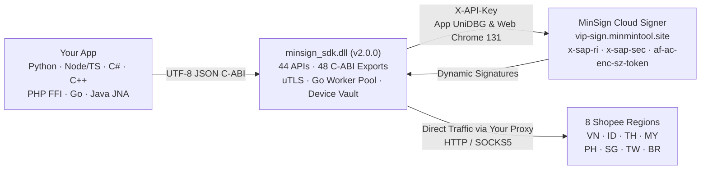

🌐 **Languages:** [English](README.md) | [Tiếng Việt](README.vi.md) | [Bahasa Indonesia](README.id.md) | [ภาษาไทย](README.th.md) | [简体中文](README.zh.md)

# ShopeeAPI — MinSign Native Universal SDK (`minsign_sdk.dll` v2.0.0)

[](./CHANGELOG.md)
[](./docs/QUICKSTART_BY_LANGUAGE.md)
[](#supported-shopee-regions)
[](#dual-signing-architecture)
[](https://vip-sign.minmintool.site)

**One native Windows x64 C-ABI library (`minsign_sdk.dll`) — 44 production Shopee & Shopee Affiliate APIs, 7 first-class language wrappers, 8 Shopee regions, and Dual App + Web Security Signing.**

Skip browser automation, emulators, and fragile reverse-engineering scripts. Ship high-throughput Shopee scrapers, Affiliate bots, Live Commerce pipelines, Visual Search tools, and Video automation directly from **Python, Node.js/TypeScript, C#, C++, PHP 8+ FFI, Go, or Java JNA** using a single zero-runtime DLL with native `uTLS` fingerprinting, sticky Android device vaulting, and multi-threaded Go worker pools.

> 📚 **Documentation Hub:** [Full 44-API JSON Reference](./docs/API_REFERENCE.md) · [Quickstart by Language (7 Stacks)](./docs/QUICKSTART_BY_LANGUAGE.md) · [End-to-End Playbooks](./docs/USE_CASES_AND_PLAYBOOKS.md) · [Changelog](./CHANGELOG.md) · [Vietnamese Deep-Dive Manual](./DOCS_MINSIGN_NATIVE_SDK.md)

---

## Dual Signing Architecture

Every Shopee HTTP/WebSocket call runs **directly from your machine through your own proxy** using native `uTLS` (Android OkHttp4 & Chrome 131 TLS fingerprints). Only cryptographic signature headers are fetched on demand from MinSign Cloud.



---

## What Can You Build?

<table>
  <tr>
    <td width="50%" valign="top">
      <h3>1. Product Intelligence &amp; Batch Scraping</h3>
      <ul>
        <li><strong>Multi-URL Parallel Fetch (<code>batch_get_product_details</code>)</strong> — Bounded Go worker pool rotating proxies &amp; cookies in order.</li>
        <li><strong>Smart URL Resolver (<code>resolve_shopee_url</code>)</strong> — Parse product, shop, video, live, and shortlinks (<code>shp.ee</code> / <code>s.shopee.*</code>) across all 8 regions.</li>
        <li><strong>Ratings, Flash Sales &amp; Recommendations</strong> — Scrape buyer reviews/media, active flash sale slots, daily discover feeds, and search autocomplete hints.</li>
      </ul>
    </td>
    <td width="50%" valign="top">
      <h3>2. Affiliate Growth &amp; Link Conversion</h3>
      <ul>
        <li><strong>High-Commission Offer Discovery (<code>get_affiliate_offer_list</code>)</strong> — Query <code>affiliate.shopee.*</code> via Web Chrome 131 Signer for commission &amp; extra seller rates.</li>
        <li><strong>Conversion Analytics (<code>get_affiliate_commission_report</code>)</strong> — Pull conversion &amp; commission reports directly into your BI dashboard.</li>
        <li><strong>Batch Shortener (<code>batch_convert_affiliate_links</code>)</strong> — Convert raw URLs, competitor <code>aff_id</code> links, or shortlinks into tracked <code>s.shopee.*</code> links with <code>subId1..5</code>.</li>
      </ul>
    </td>
  </tr>
  <tr>
    <td width="50%" valign="top">
      <h3>3. Shopee Video Studio &amp; View Booster</h3>
      <ul>
        <li><strong>4-Step Pure-API Video Upload (<code>upload_shopee_video</code>)</strong> — Attach up to 6 Affiliate cart products, Normal/Duet modes, and <code>&lt;10ms</code> MP4 MD5/SHA-256 fingerprint mutation without FFmpeg.</li>
        <li><strong>Watermark-Free Shop Video Scraper (<code>get_shop_videos</code>)</strong> — Export clean CDN <code>mp4Url</code> + attached cart items.</li>
        <li><strong>Multi-Threaded View Engine (<code>buff_video_batch</code>)</strong> — Go worker pool with real MP4 byte-range streaming &amp; <code>c-api-bit</code> telemetry.</li>
      </ul>
    </td>
    <td width="50%" valign="top">
      <h3>4. Shopee Live Viewer &amp; Bag Scraper</h3>
      <ul>
        <li><strong>Live Bag Product Scraper (<code>get_live_bag_items</code>)</strong> — Extract pinned Live shopping bag items, live-only discounts, stock, and affiliate metadata.</li>
        <li><strong>Live Session Inspector (<code>get_live_session_detail</code>)</strong> — Resolve Live URLs to <code>sessionId</code>, <code>roomId</code>, viewer counts, and CDN FLV/HLS stream URLs.</li>
        <li><strong>WebSocket + Protobuf Viewer Pool (<code>buff_live_batch</code>)</strong> — Full RFC 6455 WS over proxy + uTLS, <code>HB_REQ</code> heartbeats, and <code>SZTracker</code> reporting.</li>
      </ul>
    </td>
  </tr>
  <tr>
    <td width="50%" valign="top">
      <h3>5. Visual AI Image Search &amp; Sourcing</h3>
      <ul>
        <li><strong>Pure-HTTP Image Search (<code>search_products_by_image</code>)</strong> — Search from local files, Base64 clipboard, TikTok/1688/Taobao URLs, Shopee CDN hashes, or product links.</li>
        <li><strong>Cheaper Supplier Finder</strong> — Switch between <code>SimilarProducts</code> and <code>CheaperOptions</code> with zero browser overhead.</li>
        <li><strong>AI Object Detection (<code>get_image_bounding_box</code>)</strong> — Detect item bounding boxes (<code>0</code> cookies, <code>0</code> signing credits).</li>
      </ul>
    </td>
    <td width="50%" valign="top">
      <h3>6. Dual App + Web Security Signing</h3>
      <ul>
        <li><strong>Web Chrome 131 Signer (<code>sign_web</code>)</strong> — First-class signing for web-only portals (Affiliate Dashboard, Web Seller/Commerce endpoints) with <code>clientType: "web"</code>.</li>
        <li><strong>App Mobile UniDBG + Layer-2 Risk Token (<code>get_risk_token</code>)</strong> — Sticky Android 14 profiles in <code>devices_vault.json</code> (optional AES-256-GCM encryption) + <code>af-ac-enc-sz-token</code>.</li>
        <li><strong>Account, Cart &amp; Voucher Automation</strong> — Check cookie health (<code>get_account_profile</code>), inspect cart (<code>get_cart_summary</code>), and claim shop vouchers (<code>claim_shop_voucher</code>).</li>
      </ul>
    </td>
  </tr>
</table>

---

## Get Your `X-API-Key`

1. Visit **[https://vip-sign.minmintool.site](https://vip-sign.minmintool.site)** (supports English, Vietnamese & Thai).
2. Register or sign in with Google.
3. Top up a **Pay-As-You-Go** balance or activate a monthly plan (**Basic / Pro / VIP**) and copy your **`X-API-Key`** from **API Keys**.
4. Initialize `MinSignClient` with your key — all 44 APIs work out of the box.

---

## Quickstart Across All 7 Languages

> Need full setup notes, `x64` architecture checks, and `MinSign_Free` memory safety patterns? See [**`docs/QUICKSTART_BY_LANGUAGE.md`**](./docs/QUICKSTART_BY_LANGUAGE.md).

### 1. Python 3.8+ (Zero External Dependencies — Pure `ctypes`)

```bash
git clone https://github.com/minmin2402/shopeeapi.git
cd shopeeapi
python examples/quickstart_python.py
```

```python
from wrappers.python.minsign_sdk import MinSignClient

sdk = MinSignClient(api_key="YOUR_X_API_KEY", default_country="ID")

# 1. Resolve any Shopee URL across 8 regions
resolved = sdk.resolve_shopee_url(url="https://shopee.co.th/product/1834601441/57811171288")
print(resolved["country"], resolved["shopId"], resolved["itemId"])

# 2. Batch scrape product details concurrently inside the DLL
batch = sdk.batch_get_product_details(
    product_urls=[
        "https://shopee.co.id/product/2955704/26112249802",
        "https://shopee.co.th/product/1834601441/57811171288",
    ],
    proxies=["http://user:pass@ip:port"],
    concurrency=5,
)
print(f"Succeeded: {batch['succeeded']}/{batch['total']} in {batch['elapsedMs']}ms")

# 3. Discover high-commission Affiliate offers (Web Chrome 131 Signer)
offers = sdk.get_affiliate_offer_list(
    keyword="wireless earbuds",
    sort_type=1,
    page_limit=10,
    cookie="SPC_U=...; SPC_ST=...;",
    country="VN",
)
print("Top offer:", offers["items"][0]["name"], offers["items"][0]["commissionRate"])
```

### 2. Node.js / TypeScript / Electron (`npm install koffi`)

Full TypeScript declarations ship in [`wrappers/nodejs/minsign_sdk.d.ts`](./wrappers/nodejs/minsign_sdk.d.ts).

```javascript
const { MinSignClient } = require("./wrappers/nodejs/minsign_sdk");

(async () => {
  const sdk = new MinSignClient({ apiKey: "YOUR_X_API_KEY", defaultCountry: "VN" });

  // Non-blocking worker thread call — safe for Electron UI & Express APIs
  const ratings = await sdk.getProductRatings({
    productUrl: "https://shopee.vn/product/104187240/19894959672",
    limit: 20,
    proxy: "http://user:pass@ip:port",
  });
  console.log("Ratings fetched:", ratings.ratings?.length);

  // Scrape pinned Shopee Live shopping bag products
  const bag = await sdk.getLiveBagItems({
    liveUrl: "https://live.shopee.vn/share?session=123456789",
    limit: 20,
    country: "VN",
  });
  console.log("Live bag items:", bag.items?.length);
})();
```

### 3. C# (.NET 6/8/9 & .NET Framework 4.7.2+ — `x64`)

```csharp
using System;
using System.Text.Json;
using MinSign;

using var sdk = new MinSignClient(
    apiKey: "YOUR_X_API_KEY",
    signerUrl: "https://vip-sign.minmintool.site",
    vaultFilePath: "./minsign_data/devices_vault.json",
    defaultCountry: "ID"
);

JsonElement flashSale = sdk.GetFlashSaleItems(new { country = "ID", limit = 20 });
Console.WriteLine(flashSale.GetRawText());
```

### 4. PHP 8.1+ (`ext-ffi` Enabled)

```php
<?php
require_once __DIR__ . '/wrappers/php/MinSignSdk.php';

use MinSign\MinSignClient;

$sdk = new MinSignClient(apiKey: 'YOUR_X_API_KEY', defaultCountry: 'VN');
$resolved = $sdk->resolveShopeeUrl(['url' => 'https://shopee.vn/product/104187240/19894959672']);
print_r($resolved);
```

### 5. Go (Zero CGO — Windows `syscall.NewLazyDLL`)

```go
package main

import (
	"fmt"
	minsignclient "github.com/minmin2402/shopeeapi/wrappers/go"
)

func main() {
	client, err := minsignclient.NewClient(minsignclient.Config{
		APIKey:         "YOUR_X_API_KEY",
		DLLPath:        "./bin/win-x64/minsign_sdk.dll",
		DefaultCountry: "TH",
	})
	if err != nil {
		panic(err)
	}
	res, err := client.ResolveShopeeUrl(map[string]any{
		"url": "https://shopee.co.th/product/1834601441/57811171288",
	})
	if err != nil {
		panic(err)
	}
	fmt.Println(res)
}
```

### 6. Java 11+ (JNA)

```java
import com.minsign.sdk.MinSignSdk;

try (MinSignSdk sdk = new MinSignSdk("YOUR_X_API_KEY", null, MinSignSdk.DEFAULT_SIGNER_URL, MinSignSdk.DEFAULT_VAULT_FILE_PATH, "", "SG", 25000)) {
    String json = sdk.getSearchSuggestions("{\"keyword\":\"mechanical keyboard\",\"limit\":10,\"country\":\"SG\"}");
    System.out.println(json);
}
```

### 7. C++17 (Header-Only RAII)

```cpp
#include <iostream>
#include "wrappers/cpp/minsign_sdk_client.hpp"

int main() {
    minsign::Client sdk(R"({"apiKey":"YOUR_X_API_KEY","defaultCountry":"VN"})", "bin\\win-x64\\minsign_sdk.dll");
    std::cout << sdk.resolveShopeeUrl(R"({"url":"https://shopee.vn/product/104187240/19894959672"})") << "\n";
}
```

---

## Complete 44-API Reference (`minsign_sdk.dll` v2.0.0)

> In addition to the **44 Action APIs** below, the DLL exports **4 core C-ABI lifecycle/dispatch functions**: `MinSign_Init`, `MinSign_Version`, `MinSign_Invoke`, and `MinSign_Free` (**48 total C-ABI exports**). Full request/response JSON schemas are documented in [**`docs/API_REFERENCE.md`**](./docs/API_REFERENCE.md).

### 1. System, Device Vault & Dual Signing (7 APIs)

| # | Action (`MinSign_Invoke`) | C-ABI Export | Description | Cookie? | Version |
|---|---|---|---|---|---|
| 1 | `check_api_key` | `MinSign_CheckApiKey` | Check subscription plan, wallet balance, daily quota & RPM limit | No | `v1.0` |
| 2 | `bind_account_device` | `MinSign_BindAccountDevice` | Bind & persist a sticky Android 14 profile in `devices_vault.json` | Optional | `v1.0` |
| 3 | `list_local_devices` | `MinSign_ListLocalDevices` | List all local `Account <-> Android Device` vault entries | No | `v1.0` |
| 4 | `remove_local_device` | `MinSign_RemoveLocalDevice` | Unbind/reset a stored device profile by `accountKey` | No | `v1.0` |
| 5 | `sign_raw` | `MinSign_SignRaw` | Generate dynamic security headers (`clientType`: `"app"` or `"web"`, optional `attachRiskHeaders`) | Optional | `v1.0` / `v2.0` |
| 6 | **`sign_web`** | **`MinSign_SignWeb`** | **Sign Shopee Web Chrome 131 requests via `/api/v1/web/sign` (returns Web headers + `patchedCookie`)** | Optional | **`v2.0`** |
| 7 | `get_risk_token` | `MinSign_GetRiskToken` | Mint & cache Layer-2 Android Risk Token (`af-ac-enc-sz-token`, `dfp`, `shpSecData`) | Optional | `v1.2` |

### 2. Products, Shops, Ratings & Discovery (16 APIs)

| # | Action (`MinSign_Invoke`) | C-ABI Export | Description | Cookie? | Version |
|---|---|---|---|---|---|
| 8 | **`resolve_shopee_url`** | **`MinSign_ResolveShopeeUrl`** | **Parse product/shop/video/live/shortlinks (`shp.ee`, `s.shopee.*`) or build canonical URLs across 8 regions** | No | **`v2.0`** |
| 9 | `get_product_detail` | `MinSign_GetProductDetail` | Full product data (title, price, stock, sold, variants, HD images, video, shop info) | Optional | `v1.0` |
| 10 | **`batch_get_product_details`** | **`MinSign_BatchGetProductDetails`** | **Concurrent Go worker pool fetching multiple products with proxy/cookie rotation in order** | Optional | **`v2.0`** |
| 11 | **`get_product_ratings`** | **`MinSign_GetProductRatings`** | **Fetch paginated buyer ratings, star breakdown summary, comments & review photos/videos** | Optional | **`v2.0`** |
| 12 | **`get_flash_sale_items`** | **`MinSign_GetFlashSaleItems`** | **Fetch active Flash Sale sessions & discounted product slots by region** | Optional | **`v2.0`** |
| 13 | **`get_recommend_products`** | **`MinSign_GetRecommendProducts`** | **Fetch Daily Discover (`daily_discover_main`) or Similar Items (`item_detail_similar_items`)** | Optional | **`v2.0`** |
| 14 | **`get_search_suggestions`** | **`MinSign_GetSearchSuggestions`** | **Fetch live Shopee autocomplete keyword suggestions & search hints** | Optional | **`v2.0`** |
| 15 | `search_products` | `MinSign_SearchProducts` | Keyword product search (`relevancy`, `sales`, `ctime`, `price`) | Optional | `v1.0` |
| 16 | `search_products_by_image` | `MinSign_SearchProductsByImage` | Pure-HTTP visual search (`SimilarProducts` / `CheaperOptions`) from file, Base64, URL, or product link | **Yes (`SPC_ST`)** | `v1.3` |
| 17 | `get_image_bounding_box` | `MinSign_GetImageBoundingBox` | AI object bounding box coordinates (`left,top,width,height` — `0` signing credits) | No | `v1.3` |
| 18 | `get_shop_overview` | `MinSign_GetShopOverview` | Shop profile from URL, `shopId`, or `username` (includes Video `userId`) | No | `v1.0` |
| 19 | `get_shop_products` | `MinSign_GetShopProducts` | Paginated shop product listing (`limit`, `offset`) | No | `v1.0` |
| 20 | `get_shop_newest_products` | `MinSign_GetShopNewestProducts` | Real-time newest shop arrivals (`sinceItemId`, `sinceTimestamp`, `withinHours`, commission tags) | Optional | `v1.1` |
| 21 | `get_shop_categories` | `MinSign_GetShopCategories` | Shop internal categories | No | `v1.0` |
| 22 | `get_shop_vouchers` | `MinSign_GetShopVouchers` | Active shop vouchers & discount codes | No | `v1.0` |
| 23 | `get_category_tree` | `MinSign_GetCategoryTree` | Full official Shopee category hierarchy by region | No | `v1.0` |

### 3. Account, Cart & Vouchers (3 APIs)

| # | Action (`MinSign_Invoke`) | C-ABI Export | Description | Cookie? | Version |
|---|---|---|---|---|---|
| 24 | **`get_account_profile`** | **`MinSign_GetAccountProfile`** | **Verify cookie liveness (`alive`) & fetch `userId`, `shopId`, `username`, seller status & verification flags** | **Yes** | **`v2.0`** |
| 25 | **`get_cart_summary`** | **`MinSign_GetCartSummary`** | **Fetch shopping cart shop groups, item count & subtotal (`cart/get` with `cart/mini` fallback)** | **Yes** | **`v2.0`** |
| 26 | **`claim_shop_voucher`** | **`MinSign_ClaimShopVoucher`** | **Save/claim a shop voucher via `POST voucher_wallet/save_voucher` with auto Layer-2 Risk Headers** | **Yes** | **`v2.0`** |

### 4. Shopee Affiliate & Monetization (5 APIs)

| # | Action (`MinSign_Invoke`) | C-ABI Export | Description | Cookie? | Version |
|---|---|---|---|---|---|
| 27 | **`get_affiliate_offer_list`** | **`MinSign_GetAffiliateOfferList`** | **Discover high-commission Affiliate products via Web Chrome 131 Signer (`commissionRate`, `sellerCommissionRate`, `sales`)** | **Yes** | **`v2.0`** |
| 28 | **`get_affiliate_commission_report`** | **`MinSign_GetAffiliateCommissionReport`** | **Query Affiliate conversion & commission reports by time range via Web Chrome 131 Signer** | **Yes** | **`v2.0`** |
| 29 | `get_affiliate_products` | `MinSign_GetAffiliateProducts` | Fetch recommended Affiliate products for Shopee Video cart attachment | **Yes** | `v1.0` |
| 30 | `convert_affiliate_link` | `MinSign_ConvertAffiliateLink` | Convert & shorten any Shopee URL or existing `aff_id` link into your tracked `s.shopee.*` link (`subId1..5`) | **Yes** | `v1.5` |
| 31 | `batch_convert_affiliate_links` | `MinSign_BatchConvertAffiliateLinks` | Batch convert/shorten multiple URLs in auto-chunked GraphQL requests (`batchCustomLink`) | **Yes** | `v1.5` |

### 5. Shopee Video Studio, Scraper & View Booster (8 APIs)

| # | Action (`MinSign_Invoke`) | C-ABI Export | Description | Cookie? | Version |
|---|---|---|---|---|---|
| 32 | `upload_shopee_video` | `MinSign_UploadShopeeVideo` | 4-step pure-API Shopee Video upload + up to 6 Affiliate cart products + Normal/Duet modes | **Yes** | `v1.0` |
| 33 | `precheck_video_upload` | `MinSign_PrecheckVideoUpload` | Verify account cookie health & Shopee Video posting permission | **Yes** | `v1.0` |
| 34 | `mutate_mp4_fingerprint` | `MinSign_MutateMp4Fingerprint` | Mutate `.mp4` binary `MD5` & `SHA-256` in `<10ms` without re-encoding or FFmpeg | No | `v1.0` |
| 35 | `buff_video_view` | `MinSign_BuffVideoView` | Execute 1 full 4-step Shopee Video view (URL resolve → `timeline/single` → MP4 byte-range → `c-api-bit`) | Optional | `v1.0` |
| 36 | `buff_video_batch` | `MinSign_BuffVideoBatch` | Multi-threaded Go worker pool rotating `proxies[]` & `cookies[]` | Optional | `v1.0` |
| 37 | `get_video_detail` | `MinSign_GetVideoDetail` | Fetch video views, likes, comments, author & watermark-free `mp4Url` | Optional | `v1.0` |
| 38 | `get_shop_videos` | `MinSign_GetShopVideos` | Scrape all videos of a shop with watermark-free `mp4Url` & `attachedProducts[]` | Recommended | `v1.1` |
| 39 | `get_channel_and_hashtag_videos` | `MinSign_GetChannelAndHashtagVideos` | Fetch videos by channel `requestUserId` or `hashtagId` | Optional | `v1.0` |

### 6. Shopee Live Commerce & Viewer Engine (4 APIs)

| # | Action (`MinSign_Invoke`) | C-ABI Export | Description | Cookie? | Version |
|---|---|---|---|---|---|
| 40 | `get_live_session_detail` | `MinSign_GetLiveSessionDetail` | Resolve Live URL / `sessionId` → `roomId`, `viewerCount`, `usersig`, CDN `playUrls` | Optional | `v1.4` |
| 41 | **`get_live_bag_items`** | **`MinSign_GetLiveBagItems`** | **Scrape pinned Shopee Live shopping bag products (prices, live discounts, stock, affiliate info)** | Optional | **`v2.0`** |
| 42 | `buff_live_view` | `MinSign_BuffLiveView` | Full Live view lifecycle (`joinv2` → FLV/HLS → WS `HB_REQ` → `SZTracker` `reportPB` → optional `/like` → `/exit`) | Optional | `v1.4` |
| 43 | `buff_live_batch` | `MinSign_BuffLiveBatch` | Multi-threaded Live viewer pool with proxy/cookie rotation & optional `staggerMs` | Optional | `v1.4` |

### 7. Universal Signed HTTP Gateway (1 API)

| # | Action (`MinSign_Invoke`) | C-ABI Export | Description | Cookie? | Version |
|---|---|---|---|---|---|
| 44 | `execute_signed_request` | `MinSign_ExecuteSignedRequest` | Sign & execute **any** Shopee GET/POST endpoint over `uTLS` + Proxy (supports `clientType: "app"\|"web"` & `attachRiskHeaders`) | Optional | `v1.0` / `v2.0` |

---

## Supported Shopee Regions

| Code | Region | Domain | Currency |
|---|---|---|---|
| `VN` | Vietnam | `shopee.vn` | VND (`₫`) |
| `ID` | Indonesia | `shopee.co.id` | IDR (`Rp`) |
| `TH` | Thailand | `shopee.co.th` | THB (`฿`) |
| `MY` | Malaysia | `shopee.com.my` | MYR (`RM`) |
| `PH` | Philippines | `shopee.ph` | PHP (`₱`) |
| `SG` | Singapore | `shopee.sg` | SGD (`S$`) |
| `TW` | Taiwan | `shopee.tw` | TWD (`NT$`) |
| `BR` | Brazil | `shopee.com.br` | BRL (`R$`) |

---

## Repository Structure

```text
shopeeapi/
├── bin/win-x64/
│   ├── minsign_sdk.dll                    # Native Windows x64 Core Library (v2.0.0 — 48 C-ABI Exports)
│   └── minsign_sdk.h                      # Generated C Header
├── include/
│   └── minsign_sdk.h                      # Standard C / C++ Header
├── wrappers/
│   ├── python/minsign_sdk.py              # Python 3.8+ (pure ctypes, 0 dependencies)
│   ├── nodejs/
│   │   ├── minsign_sdk.js                 # Node.js / Electron Async Wrapper (koffi)
│   │   └── minsign_sdk.d.ts               # Full TypeScript Definitions (44 APIs)
│   ├── csharp/MinSignSdk.cs               # C# (.NET Framework 4.7.2+ / .NET 6-9 x64)
│   ├── cpp/minsign_sdk_client.hpp         # C++17 Header-only RAII Wrapper
│   ├── php/MinSignSdk.php                 # PHP 8.1+ Built-in FFI Wrapper
│   ├── go/minsign.go                      # Go Windows LazyDLL Wrapper (0 CGO)
│   └── java/MinSignSdk.java               # Java 11+ JNA Wrapper
├── examples/
│   ├── quickstart_python.py               # Python Quickstart
│   ├── batch_product_scraper.py           # v2.0 Batch Scraper + URL Resolver + Ratings
│   ├── affiliate_hunter.py                # v2.0 Affiliate Offer Hunter + Batch Converter + Report
│   ├── live_bag_scraper.py                # v2.0 Live Session + Bag Items + Account Health
│   ├── image_search_shopee.py             # Visual Search & AI Bounding Box
│   ├── buff_view_shopee_video.py          # Single & Batch Video View Booster
│   ├── buff_view_shopee_live.py           # Shopee Live View Booster
│   ├── quickstart_nodejs.js               # Node.js Quickstart
│   ├── QuickstartCSharp.cs                # C# Quickstart
│   ├── quickstart_cpp.cpp                 # C++17 Quickstart
│   ├── quickstart_php.php                 # PHP 8+ FFI Quickstart
│   ├── quickstart_go.go                   # Go LazyDLL Quickstart
│   └── QuickstartJava.java                # Java JNA Quickstart
├── docs/
│   ├── API_REFERENCE.md                   # Detailed JSON Contracts for All 44 APIs
│   ├── QUICKSTART_BY_LANGUAGE.md          # Setup, Architecture & Runnable Snippets (7 Languages)
│   └── USE_CASES_AND_PLAYBOOKS.md         # 5 End-to-End Production Automation Recipes
├── CHANGELOG.md                           # Full Version History (v1.0.0 -> v2.0.0)
├── DOCS_MINSIGN_NATIVE_SDK.md             # Detailed Technical Manual (Vietnamese)
├── DOCS_TIM_SAN_PHAM_BANG_ANH.md          # Visual Search & AI Crop Guide (Vietnamese)
├── TERMS_OF_SERVICE.md                    # Legal Terms & Disclaimer
├── README.md                              # English (Primary)
├── README.vi.md                           # Tiếng Việt
├── README.id.md                           # Bahasa Indonesia
├── README.th.md                           # ภาษาไทย
└── README.zh.md                           # 简体中文
```

---

## Documentation & Guides

- **[`docs/API_REFERENCE.md`](./docs/API_REFERENCE.md)** — Complete request/response JSON contracts for all 44 APIs, error envelope format, proxy & cookie rules.
- **[`docs/QUICKSTART_BY_LANGUAGE.md`](./docs/QUICKSTART_BY_LANGUAGE.md)** — Installation, `x64` requirements, `MinSign_Free` memory safety, and runnable code for all 7 languages.
- **[`docs/USE_CASES_AND_PLAYBOOKS.md`](./docs/USE_CASES_AND_PLAYBOOKS.md)** — 5 end-to-end production blueprints (Multi-Region Price Monitor, High-Commission Affiliate Bot, Live Bag Pipeline, Visual Sourcing, Video Auto-Uploader).
- **[`CHANGELOG.md`](./CHANGELOG.md)** — Complete release notes from `v1.0.0` through `v2.0.0`.
- **[`DOCS_MINSIGN_NATIVE_SDK.md`](./DOCS_MINSIGN_NATIVE_SDK.md)** — Deep-dive technical handbook in Vietnamese.

---

## Terms of Service & License

See [`TERMS_OF_SERVICE.md`](./TERMS_OF_SERVICE.md) and [`LICENSE`](./LICENSE). Provided **AS-IS** for protocol research, sandbox testing, and authorized internal automation.
