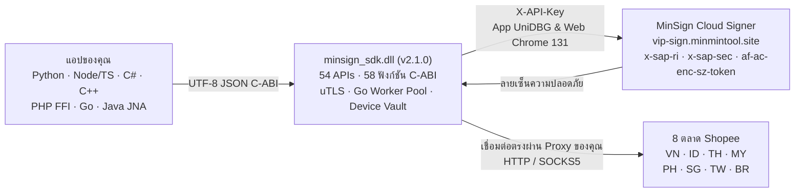

🌐 **ภาษา:** [English](README.md) | [Tiếng Việt](README.vi.md) | [Bahasa Indonesia](README.id.md) | [ภาษาไทย](README.th.md) | [简体中文](README.zh.md)

# ShopeeAPI — MinSign Native Universal SDK (`minsign_sdk.dll` v2.1.0)

[](./CHANGELOG.md)
[](./docs/QUICKSTART_BY_LANGUAGE.md)
[](#รองรับ-8-ตลาด-shopee)
[](#สถาปัตยกรรม-dual-signing)
[](https://vip-sign.minmintool.site)

**ไลบรารีเนทีฟ Windows x64 C-ABI ไฟล์เดียว (`minsign_sdk.dll`) — ครบเครื่อง 54 API สำหรับ Shopee, MCN และ Shopee Affiliate พร้อม Wrapper ทางการ 7 ภาษา รองรับ 8 ประเทศ และระบบเซ็นลายเซ็นคู่ (App Mobile UniDBG + Web Chrome 131)**

ไม่ต้องเปิดเบราว์เซอร์ ไม่ต้องรันอีมูเลเตอร์ และไม่ต้องปวดหัวกับสคริปต์กันบอท สร้างระบบดึงข้อมูลสินค้า Shopee ความเร็วสูง บอท Affiliate ค่าคอมสูง ระบบจัดการ MCN และตอบรับคำเชิญอัตโนมัติ ระบบ Shopee Live / Shopee Video และค้นหาสินค้าด้วยภาพได้ทันทีจาก **Python, Node.js/TypeScript, C#, C++, PHP 8+ FFI, Go หรือ Java JNA** ผ่าน DLL ไฟล์เดียวที่มาพร้อม `uTLS` เนทีฟ, คลังอุปกรณ์ Android ประจำบัญชี (`devices_vault.json`) และ Go Worker Pool แบบมัลติเธรด

> 📚 **ศูนย์เอกสาร:** [คู่มือ JSON ครบ 54 API (EN)](./docs/API_REFERENCE.md) · [เริ่มต้นใช้งาน 7 ภาษา (EN)](./docs/QUICKSTART_BY_LANGUAGE.md) · [สูตรสำเร็จงานอัตโนมัติ (EN)](./docs/USE_CASES_AND_PLAYBOOKS.md) · [ประวัติเวอร์ชัน](./CHANGELOG.md)

---

## สถาปัตยกรรม Dual Signing

ทราฟฟิก HTTP/WebSocket ทั้งหมดที่ยิงไปยัง Shopee วิ่ง **ตรงจากเครื่องของคุณผ่าน Proxy ของคุณเอง** ด้วยลายนิ้วมือเครือข่าย `uTLS` (Android OkHttp4 & Chrome 131) โดย MinSign Cloud ทำหน้าที่ออกลายเซ็นความปลอดภัยแบบเรียลไทม์เท่านั้น



---

## สร้างอะไรได้บ้างด้วย v2.1.0?

<table>
  <tr>
    <td width="50%" valign="top">
      <h3>1. ดึงข้อมูลสินค้า &amp; สแครปแบบแบตช์</h3>
      <ul>
        <li><strong>ดึงรายละเอียดสินค้าพร้อมกันหลายรายการ (<code>batch_get_product_details</code>)</strong> — Go Worker Pool สลับ Proxy และ Cookie อัตโนมัติพร้อมคงลำดับข้อมูล</li>
        <li><strong>ตัวแปลงลิงก์ Shopee อัจฉริยะ (<code>resolve_shopee_url</code>)</strong> — แกะลิงก์สินค้า ร้านค้า วิดีโอ ไลฟ์ และลิงก์ย่อ (<code>shp.ee</code> / <code>s.shopee.*</code>) ครบทั้ง 8 ประเทศ</li>
        <li><strong>รีวิว, Flash Sale และสินค้าแนะนำ</strong> — ดึงรีวิวพร้อมรูป/วิดีโอ (<code>get_product_ratings</code>), รอบ Flash Sale, ฟีดสินค้าแนะนำ และคำค้นหายอดนิยม</li>
      </ul>
    </td>
    <td width="50%" valign="top">
      <h3>2. ระบบ Affiliate &amp; แปลงลิงก์ค่าคอมสูง</h3>
      <ul>
        <li><strong>ค้นหาสินค้าค่าคอมสูง (<code>get_affiliate_offer_list</code>)</strong> — เรียก <code>affiliate.shopee.*</code> ผ่าน Web Chrome 131 Signer ดูค่าคอมพื้นฐานและค่าคอมพิเศษจากร้านค้า</li>
        <li><strong>รายงานค่าคอมมิชชัน (<code>get_affiliate_commission_report</code>)</strong> — ดึงข้อมูลออเดอร์และค่าคอมเข้าสู่แดชบอร์ดของคุณโดยตรง</li>
        <li><strong>แปลงลิงก์ Affiliate แบบกลุ่ม (<code>batch_convert_affiliate_links</code>)</strong> — แปลงลิงก์สินค้าปกติหรือลิงก์ <code>aff_id</code> อื่นเป็นลิงก์ย่อ <code>s.shopee.*</code> พร้อมติด <code>subId1..5</code></li>
      </ul>
    </td>
  </tr>
  <tr>
    <td width="50%" valign="top">
      <h3>3. Shopee Video Studio &amp; ปั๊มวิว</h3>
      <ul>
        <li><strong>อัปโหลดวิดีโอผ่าน API 4 ขั้นตอน (<code>upload_shopee_video</code>)</strong> — ปักตะกร้า Affiliate ได้สูงสุด 6 ชิ้น รองรับ Normal/Duet พร้อมเปลี่ยนค่าแฮช MP4 (<code>MD5</code>/<code>SHA-256</code>) ใน <code>&lt;10ms</code> โดยไม่ใช้ FFmpeg</li>
        <li><strong>ดูดวิดีโอร้านค้าไร้ลายน้ำ (<code>get_shop_videos</code>)</strong> — ได้ลิงก์ <code>mp4Url</code> ต้นฉบับพร้อมรายการสินค้าในตะกร้า (<code>attachedProducts[]</code>)</li>
        <li><strong>ปั๊มวิวมัลติเธรด (<code>buff_video_batch</code>)</strong> — โหลดไบต์ MP4 จริงผ่าน Proxy พร้อมส่งอีเวนต์ <code>c-api-bit</code></li>
      </ul>
    </td>
    <td width="50%" valign="top">
      <h3>4. Shopee Live &amp; ดึงสินค้าตะกร้าส้ม</h3>
      <ul>
        <li><strong>ดึงสินค้าในตะกร้า Live (<code>get_live_bag_items</code>)</strong> — ดึงสินค้าที่ปักหมุดในตะกร้าไลฟ์ ราคาพิเศษเฉพาะไลฟ์ สต็อก และข้อมูล Affiliate</li>
        <li><strong>ตรวจสอบห้องไลฟ์ (<code>get_live_session_detail</code>)</strong> — แปลงลิงก์ไลฟ์เป็น <code>sessionId</code>, <code>roomId</code>, ยอดคนดู และลิงก์สตรีม FLV/HLS</li>
        <li><strong>ระบบคนดู WebSocket + Protobuf (<code>buff_live_batch</code>)</strong> — เชื่อมต่อ WS RFC 6455 ผ่าน Proxy ส่ง <code>HB_REQ</code> และรายงาน <code>SZTracker</code></li>
      </ul>
    </td>
  </tr>
  <tr>
    <td width="50%" valign="top">
      <h3>5. ค้นหาสินค้าด้วยภาพ AI &amp; หาแหล่งราคาถูก</h3>
      <ul>
        <li><strong>ค้นหาด้วยรูปผ่าน HTTP ล้วน (<code>search_products_by_image</code>)</strong> — รองรับ 5 แหล่งภาพ (ไฟล์ในเครื่อง, Base64, ลิงก์ TikTok/1688/Taobao, Shopee CDN หรือลิงก์สินค้า)</li>
        <li><strong>ค้นหาร้านที่ขายถูกกว่า (<code>CheaperOptions</code>)</strong> — เทียบราคาซัพพลายเออร์ได้โดยไม่ใช้เบราว์เซอร์</li>
        <li><strong>ตรวจจับกรอบวัตถุด้วย AI (<code>get_image_bounding_box</code>)</strong> — คืนค่าพิกัดวัตถุในภาพ (ใช้ <code>0</code> คุกกี้ และ <code>0</code> เครดิต)</li>
      </ul>
    </td>
    <td width="50%" valign="top">
      <h3>6. Dual Signing (App + Web) &amp; จัดการบัญชี</h3>
      <ul>
        <li><strong>Web Chrome 131 Signer (<code>sign_web</code>)</strong> — เซ็นคำขอสำหรับพอร์ทัลเว็บและ Affiliate ด้วย <code>clientType: "web"</code></li>
        <li><strong>Layer-2 Risk Token &amp; Device Vault (<code>get_risk_token</code>)</strong> — ผูกโปรไฟล์ Android 14 ประจำบัญชีใน <code>devices_vault.json</code> (รองรับเข้ารหัส AES-256-GCM) + <code>af-ac-enc-sz-token</code></li>
        <li><strong>เช็กคุกกี้, ตะกร้า &amp; เก็บโค้ดส่วนลด</strong> — ตรวจสถานะบัญชี (<code>get_account_profile</code>), ดูตะกร้า (<code>get_cart_summary</code>) และเก็บคูปองร้าน (<code>claim_shop_voucher</code>)</li>
      </ul>
    </td>
  </tr>
</table>

---

## วิธีรับคีย์ `X-API-Key`

1. เข้าไปที่ **[https://vip-sign.minmintool.site](https://vip-sign.minmintool.site)** (รองรับภาษาไทย, อังกฤษ และเวียดนาม)
2. สมัครสมาชิกหรือเข้าสู่ระบบด้วย Google
3. เติมเงินแบบ **Pay-As-You-Go** หรือเลือกแพ็กเกจรายเดือน (**Basic / Pro / VIP**) แล้วคัดลอก **`X-API-Key`** จากเมนู **API Keys**
4. นำ `X-API-Key` ไปกำหนดใน `MinSignClient` เพื่อใช้งานครบทั้ง 54 API ได้ทันที

---

## เริ่มต้นใช้งานด่วน (7 ภาษา)

> ดูคู่มือติดตั้ง ข้อกำหนด `x64` และการคืนหน่วยความจำ `MinSign_Free` ครบทั้ง 7 ภาษาได้ที่ [**`docs/QUICKSTART_BY_LANGUAGE.md`**](./docs/QUICKSTART_BY_LANGUAGE.md)

### Python 3.8+ (ไม่ต้องติดตั้งแพ็กเกจเสริม — ใช้ `ctypes` มาตรฐาน)

```python
from wrappers.python.minsign_sdk import MinSignClient

sdk = MinSignClient(api_key="YOUR_X_API_KEY", default_country="TH")

# 1. แกะลิงก์ Shopee ได้ทั้ง 8 ประเทศ
resolved = sdk.resolve_shopee_url(url="https://shopee.co.th/product/1834601441/57811171288")
print(resolved["country"], resolved["shopId"], resolved["itemId"])

# 2. ดึงข้อมูลหลายสินค้าพร้อมกันภายใน DLL
batch = sdk.batch_get_product_details(
    product_urls=[
        "https://shopee.co.th/product/1834601441/57811171288",
        "https://shopee.co.id/product/2955704/26112249802",
    ],
    proxies=["http://user:pass@ip:port"],
    concurrency=5,
)
print(f"สำเร็จ: {batch['succeeded']}/{batch['total']} ใน {batch['elapsedMs']}ms")

# 3. ค้นหาสินค้า Affiliate ค่าคอมสูง (Web Chrome 131 Signer)
offers = sdk.get_affiliate_offer_list(
    keyword="หูฟังบลูทูธ",
    sort_type=1,
    page_limit=10,
    cookie="SPC_U=...; SPC_ST=...;",
    country="TH",
)
print("ดีลเด่น:", offers["items"][0]["name"], offers["items"][0]["commissionRate"])
```

### Node.js / TypeScript (`npm install koffi`)

```javascript
const { MinSignClient } = require("./wrappers/nodejs/minsign_sdk");

(async () => {
  const sdk = new MinSignClient({ apiKey: "YOUR_X_API_KEY", defaultCountry: "TH" });
  const bag = await sdk.getLiveBagItems({
    liveUrl: "https://live.shopee.co.th/share?session=123456789",
    limit: 20,
    country: "TH",
  });
  console.log("สินค้าในตะกร้า Live:", bag.items?.length);
})();
```

### C# (.NET 6/8/9 & .NET Framework 4.7.2+ — `x64`)

```csharp
using var sdk = new MinSignClient(apiKey: "YOUR_X_API_KEY", defaultCountry: "TH");
var flashSale = sdk.GetFlashSaleItems(new { country = "TH", limit = 20 });
Console.WriteLine(flashSale.GetRawText());
```

### PHP 8.1+ (FFI), Go (Zero CGO), Java (JNA) และ C++17
- **PHP FFI:** [`wrappers/php/MinSignSdk.php`](./wrappers/php/MinSignSdk.php) · [`examples/quickstart_php.php`](./examples/quickstart_php.php)
- **Go LazyDLL:** [`wrappers/go/minsign.go`](./wrappers/go/minsign.go) · [`examples/quickstart_go.go`](./examples/quickstart_go.go)
- **Java JNA:** [`wrappers/java/MinSignSdk.java`](./wrappers/java/MinSignSdk.java) · [`examples/QuickstartJava.java`](./examples/QuickstartJava.java)
- **C++17 RAII:** [`wrappers/cpp/minsign_sdk_client.hpp`](./wrappers/cpp/minsign_sdk_client.hpp) · [`examples/quickstart_cpp.cpp`](./examples/quickstart_cpp.cpp)

---

## ตารางอ้างอิงครบทั้ง 54 API (`minsign_sdk.dll` v2.1.0)

> นอกเหนือจาก **54 Action API** ด้านล่าง DLL ยังมี **4 ฟังก์ชันแกนหลัก C-ABI** ได้แก่ `MinSign_Init`, `MinSign_Version`, `MinSign_Invoke` และ `MinSign_Free` (**รวม 58 C-ABI Exports**) ดูโครงสร้าง JSON อย่างละเอียดที่ [**`docs/API_REFERENCE.md`**](./docs/API_REFERENCE.md)

### 1. ระบบ, คลังอุปกรณ์ & Dual Signing (7 API)

| # | Action (`MinSign_Invoke`) | C-ABI Export | คำอธิบาย | ใช้ Cookie? | เวอร์ชัน |
|---|---|---|---|---|---|
| 1 | `check_api_key` | `MinSign_CheckApiKey` | ตรวจสอบแพ็กเกจ ยอดเงินคงเหลือ โควตารายวัน และ RPM | ไม่ | `v1.0` |
| 2 | `bind_account_device` | `MinSign_BindAccountDevice` | ผูกโปรไฟล์ Android 14 ประจำบัญชีลงใน `devices_vault.json` | ไม่บังคับ | `v1.0` |
| 3 | `list_local_devices` | `MinSign_ListLocalDevices` | แสดงรายการ `บัญชี <-> อุปกรณ์` ที่บันทึกไว้ในเครื่อง | ไม่ | `v1.0` |
| 4 | `remove_local_device` | `MinSign_RemoveLocalDevice` | ลบโปรไฟล์อุปกรณ์ตาม `accountKey` เพื่อสร้างเครื่องใหม่ | ไม่ | `v1.0` |
| 5 | `sign_raw` | `MinSign_SignRaw` | ขอ Header ลายเซ็นความปลอดภัย (`clientType: "app"\|"web"` & `attachRiskHeaders`) | ไม่บังคับ | `v1.0` / `v2.0` |
| 6 | **`sign_web`** | **`MinSign_SignWeb`** | **เซ็นคำขอฝั่งเว็บ Chrome 131 ผ่าน `/api/v1/web/sign` (คืน Web headers + `patchedCookie`)** | ไม่บังคับ | **`v2.0`** |
| 7 | `get_risk_token` | `MinSign_GetRiskToken` | สร้างและแคช Layer-2 Risk Token (`af-ac-enc-sz-token`, `dfp`, `shpSecData`) | ไม่บังคับ | `v1.2` |

### 2. สินค้า, ร้านค้า, รีวิว และการค้นพบ (16 API)

| # | Action (`MinSign_Invoke`) | C-ABI Export | คำอธิบาย | ใช้ Cookie? | เวอร์ชัน |
|---|---|---|---|---|---|
| 8 | **`resolve_shopee_url`** | **`MinSign_ResolveShopeeUrl`** | **แกะลิงก์สินค้า/ร้าน/วิดีโอ/ไลฟ์/ลิงก์ย่อ (`shp.ee`, `s.shopee.*`) ครบ 8 ประเทศ** | ไม่ | **`v2.0`** |
| 9 | `get_product_detail` | `MinSign_GetProductDetail` | ข้อมูลสินค้าครบถ้วน (ราคา สต็อก ยอดขาย ตัวเลือก รูป HD ข้อมูลร้าน) | ไม่บังคับ | `v1.0` |
| 10 | **`batch_get_product_details`** | **`MinSign_BatchGetProductDetails`** | **ดึงหลายสินค้าพร้อมกันด้วย Go Worker Pool สลับ Proxy/Cookie คงลำดับเดิม** | ไม่บังคับ | **`v2.0`** |
| 11 | **`get_product_ratings`** | **`MinSign_GetProductRatings`** | **ดึงรีวิวผู้ซื้อแบบแบ่งหน้า สรุปคะแนนดาว และรูป/วิดีโอรีวิว** | ไม่บังคับ | **`v2.0`** |
| 12 | **`get_flash_sale_items`** | **`MinSign_GetFlashSaleItems`** | **ดึงรอบ Flash Sale ที่กำลังเปิดขายและรายการสินค้าลดราคา** | ไม่บังคับ | **`v2.0`** |
| 13 | **`get_recommend_products`** | **`MinSign_GetRecommendProducts`** | **ดึงฟีดแนะนำประจำวัน (`daily_discover_main`) หรือสินค้าคล้ายกัน** | ไม่บังคับ | **`v2.0`** |
| 14 | **`get_search_suggestions`** | **`MinSign_GetSearchSuggestions`** | **ดึงคำแนะนำการค้นหาแบบเรียลไทม์ (autocomplete)** | ไม่บังคับ | **`v2.0`** |
| 15 | `search_products` | `MinSign_SearchProducts` | ค้นหาสินค้าตามคำค้น (`relevancy`, `sales`, `ctime`, `price`) | ไม่บังคับ | `v1.0` |
| 16 | `search_products_by_image` | `MinSign_SearchProductsByImage` | ค้นหาสินค้าด้วยภาพผ่าน HTTP ล้วน (`SimilarProducts` / `CheaperOptions`) | **ใช้ (`SPC_ST`)** | `v1.3` |
| 17 | `get_image_bounding_box` | `MinSign_GetImageBoundingBox` | AI ตรวจจับกรอบวัตถุในภาพ (`left,top,width,height` — `0` เครดิต) | ไม่ | `v1.3` |
| 18 | `get_shop_overview` | `MinSign_GetShopOverview` | ข้อมูลร้านค้าจาก URL, `shopId` หรือ `username` (รวม Video `userId`) | ไม่ | `v1.0` |
| 19 | `get_shop_products` | `MinSign_GetShopProducts` | รายการสินค้าในร้านแบบแบ่งหน้า (`limit`, `offset`) | ไม่ | `v1.0` |
| 20 | `get_shop_newest_products` | `MinSign_GetShopNewestProducts` | ติดตามสินค้าลงใหม่ของร้านแบบเรียลไทม์ (`sinceItemId`, `withinHours`) | ไม่บังคับ | `v1.1` |
| 21 | `get_shop_categories` | `MinSign_GetShopCategories` | หมวดหมู่ภายในร้านค้า | ไม่ | `v1.0` |
| 22 | `get_shop_vouchers` | `MinSign_GetShopVouchers` | คูปองส่วนลดที่ร้านเปิดให้เก็บ | ไม่ | `v1.0` |
| 23 | `get_category_tree` | `MinSign_GetCategoryTree` | โครงสร้างหมวดหมู่สินค้าทางการของ Shopee ตามประเทศ | ไม่ | `v1.0` |

### 3. บัญชี, ตะกร้าสินค้า และคูปอง (3 API)

| # | Action (`MinSign_Invoke`) | C-ABI Export | คำอธิบาย | ใช้ Cookie? | เวอร์ชัน |
|---|---|---|---|---|---|
| 24 | **`get_account_profile`** | **`MinSign_GetAccountProfile`** | **เช็กความสมบูรณ์คุกกี้ (`alive`) และดึง `userId`, `shopId`, `username`, สถานะผู้ขาย** | **ใช้** | **`v2.0`** |
| 25 | **`get_cart_summary`** | **`MinSign_GetCartSummary`** | **สรุปรายการในตะกร้าสินค้า (แยกตามร้าน จำนวนชิ้น ยอดรวม)** | **ใช้** | **`v2.0`** |
| 26 | **`claim_shop_voucher`** | **`MinSign_ClaimShopVoucher`** | **กดเก็บคูปองร้านค้าอัตโนมัติพร้อมแนบ Layer-2 Risk Headers** | **ใช้** | **`v2.0`** |

### 4. Shopee Affiliate และการสร้างรายได้ (5 API)

| # | Action (`MinSign_Invoke`) | C-ABI Export | คำอธิบาย | ใช้ Cookie? | เวอร์ชัน |
|---|---|---|---|---|---|
| 27 | **`get_affiliate_offer_list`** | **`MinSign_GetAffiliateOfferList`** | **ค้นหาสินค้า Affiliate ค่าคอมสูงผ่าน Web Chrome 131 Signer (`commissionRate`, `sales`)** | **ใช้** | **`v2.0`** |
| 28 | **`get_affiliate_commission_report`** | **`MinSign_GetAffiliateCommissionReport`** | **ดึงรายงานคอนเวอร์ชันและค่าคอม Affiliate ตามช่วงเวลา** | **ใช้** | **`v2.0`** |
| 29 | `get_affiliate_products` | `MinSign_GetAffiliateProducts` | รายการสินค้า Affiliate แนะนำสำหรับติดตะกร้า Shopee Video | **ใช้** | `v1.0` |
| 30 | `convert_affiliate_link` | `MinSign_ConvertAffiliateLink` | แปลงและย่อลิงก์ Shopee เป็นลิงก์ `s.shopee.*` ของบัญชีคุณ (`subId1..5`) | **ใช้** | `v1.5` |
| 31 | `batch_convert_affiliate_links` | `MinSign_BatchConvertAffiliateLinks` | แปลงลิงก์ Affiliate แบบกลุ่มในคำขอ GraphQL เดียว | **ใช้** | `v1.5` |

### 5. Shopee Video Studio, ดูดวิดีโอ และปั๊มวิว (8 API)

| # | Action (`MinSign_Invoke`) | C-ABI Export | คำอธิบาย | ใช้ Cookie? | เวอร์ชัน |
|---|---|---|---|---|---|
| 32 | `upload_shopee_video` | `MinSign_UploadShopeeVideo` | อัปโหลด Shopee Video ผ่าน API 4 ขั้นตอน + ตะกร้า Affiliate สูงสุด 6 ชิ้น + Normal/Duet | **ใช้** | `v1.0` |
| 33 | `precheck_video_upload` | `MinSign_PrecheckVideoUpload` | ตรวจสอบสถานะคุกกี้และสิทธิ์การโพสต์ Shopee Video | **ใช้** | `v1.0` |
| 34 | `mutate_mp4_fingerprint` | `MinSign_MutateMp4Fingerprint` | เปลี่ยนค่าแฮชไบนารี `MD5` & `SHA-256` ของ `.mp4` ใน `<10ms` ไม่ต้องใช้ FFmpeg | ไม่ | `v1.0` |
| 35 | `buff_video_view` | `MinSign_BuffVideoView` | ส่ง 1 ยอดวิว Shopee Video ครบ 4 ขั้นตอนผ่าน Proxy | ไม่บังคับ | `v1.0` |
| 36 | `buff_video_batch` | `MinSign_BuffVideoBatch` | ปั๊มวิวแบบมัลติเธรดด้วย Go Worker Pool สลับ `proxies[]` & `cookies[]` | ไม่บังคับ | `v1.0` |
| 37 | `get_video_detail` | `MinSign_GetVideoDetail` | ดึงสถิติวิดีโอ (วิว ไลก์ คอมเมนต์ และลิงก์ `mp4Url` ไร้ลายน้ำ) | ไม่บังคับ | `v1.0` |
| 38 | `get_shop_videos` | `MinSign_GetShopVideos` | ดึงวิดีโอทั้งหมดของร้านค้าพร้อม `mp4Url` และ `attachedProducts[]` | แนะนำ | `v1.1` |
| 39 | `get_channel_and_hashtag_videos` | `MinSign_GetChannelAndHashtagVideos` | ดึงวิดีโอตามช่อง `requestUserId` หรือ `hashtagId` | ไม่บังคับ | `v1.0` |

### 6. Shopee Live Commerce และระบบคนดู (4 API)

| # | Action (`MinSign_Invoke`) | C-ABI Export | คำอธิบาย | ใช้ Cookie? | เวอร์ชัน |
|---|---|---|---|---|---|
| 40 | `get_live_session_detail` | `MinSign_GetLiveSessionDetail` | แกะลิงก์ไลฟ์ / `sessionId` → `roomId`, `viewerCount`, `usersig`, `playUrls` | ไม่บังคับ | `v1.4` |
| 41 | **`get_live_bag_items`** | **`MinSign_GetLiveBagItems`** | **ดึงสินค้าในตะกร้าส้ม Live (ราคาไลฟ์ ส่วนลด สต็อก ข้อมูล Affiliate)** | ไม่บังคับ | **`v2.0`** |
| 42 | `buff_live_view` | `MinSign_BuffLiveView` | จำลองคนดูไลฟ์ครบวงจร (`joinv2` → FLV/HLS → WS `HB_REQ` → `reportPB` → `/exit`) | ไม่บังคับ | `v1.4` |
| 43 | `buff_live_batch` | `MinSign_BuffLiveBatch` | ระบบคนดูไลฟ์มัลติเธรดสลับ `proxies[]` & `cookies[]` | ไม่บังคับ | `v1.4` |

### 7. เกตเวย์ HTTP พร้อมลายเซ็นแบบอเนกประสงค์ (1 API)

| # | Action (`MinSign_Invoke`) | C-ABI Export | คำอธิบาย | ใช้ Cookie? | เวอร์ชัน |
|---|---|---|---|---|---|
| 44 | `execute_signed_request` | `MinSign_ExecuteSignedRequest` | เซ็นและยิง **API Shopee GET/POST ใดก็ได้** ผ่าน `uTLS` + Proxy (`clientType: "app"\|"web"` & `attachRiskHeaders`) | ไม่บังคับ | `v1.0` / `v2.0` |

### 8. Shopee MCN, ตอบรับคำเชิญ (`acp`) และศูนย์ Affiliate (10 API — *ใหม่ใน v2.1*)

| # | Action (`MinSign_Invoke`) | C-ABI Export | คำอธิบาย | ใช้ Cookie? | เวอร์ชัน |
|---|---|---|---|---|---|
| 45 | **`get_affiliate_user_profile`** | **`MinSign_GetAffiliateUserProfile`** | **ดึงโปรไฟล์ Affiliate, `affiliateId`, สถานะบัญชี/ภาษี และ `isAllowMcnSetAds`** | **ใช้** | **`v2.1`** |
| 46 | **`get_mcn_partnership_status`** | **`MinSign_GetMcnPartnershipStatus`** | **สแกนสถานะ MCN ปัจจุบันและคำเชิญ MCN ที่รออนุมัติ (GraphQL + REST fallback)** | **ใช้** | **`v2.1`** |
| 47 | **`reply_mcn_invitation`** (`acp_mcn_invitation`) | **`MinSign_ReplyMcnInvitation`** | **ตอบรับ (`accept`) หรือปฏิเสธ (`reject`) คำเชิญ MCN (`mcnKOLReplyToMCNRequest`)** | **ใช้** | **`v2.1`** |
| 48 | **`get_mcn_kol_partnerships`** | **`MinSign_GetMcnKolPartnerships`** | **ดึงรายชื่อความร่วมมือ KOL/Affiliate จากพอร์ทัล MCN (`mcn.affiliate.shopee.*`)** | **ใช้** | **`v2.1`** |
| 49 | **`send_mcn_partnership_invitation`** | **`MinSign_SendMcnPartnershipInvitation`** | **ตรวจสอบ username/ID และส่งคำเชิญเข้าร่วม MCN ถึง KOL/Affiliate** | **ใช้** | **`v2.1`** |
| 50 | **`manage_mcn_partnership`** | **`MinSign_ManageMcnPartnership`** | **จัดการสัญญาฝั่ง MCN (`reply`\|`accept`\|`reject`\|`change_fee`\|`extend`\|`cancel`\|`history`)** | **ใช้** | **`v2.1`** |
| 51 | **`get_mcn_analytics`** | **`MinSign_GetMcnAnalytics`** | **ดึงสถิติ MCN, ประสิทธิภาพ Affiliate, แคมเปญ และข้อมูลพื้นฐาน MCN** | **ใช้** | **`v2.1`** |
| 52 | **`get_affiliate_payment_tax`** | **`MinSign_GetAffiliatePaymentTax`** | **ตรวจสอบบัญชีธนาคาร เลขประจำตัวผู้เสียภาษี TIN/CCCD และอัตราภาษี EWT/VAT** | **ใช้** | **`v2.1`** |
| 53 | **`get_affiliate_click_report`** | **`MinSign_GetAffiliateClickReport`** | **ดึงรายงานการคลิกลิงก์ Affiliate (`/api/v1/click_report/list`)** | **ใช้** | **`v2.1`** |
| 54 | **`get_affiliate_billing`** | **`MinSign_GetAffiliateBilling`** | **ดึงบิลการจ่ายเงิน Affiliate และรายละเอียดค่าธรรมเนียม MCN ที่ถูกหัก** | **ใช้** | **`v2.1`** |

---

## รองรับ 8 ตลาด Shopee

| รหัส | ประเทศ/ภูมิภาค | โดเมน | สกุลเงิน |
|---|---|---|---|
| `VN` | เวียดนาม | `shopee.vn` | VND (`₫`) |
| `ID` | อินโดนีเซีย | `shopee.co.id` | IDR (`Rp`) |
| `TH` | ไทย | `shopee.co.th` | THB (`฿`) |
| `MY` | มาเลเซีย | `shopee.com.my` | MYR (`RM`) |
| `PH` | ฟิลิปปินส์ | `shopee.ph` | PHP (`₱`) |
| `SG` | สิงคโปร์ | `shopee.sg` | SGD (`S$`) |
| `TW` | ไต้หวัน | `shopee.tw` | TWD (`NT$`) |
| `BR` | บราซิล | `shopee.com.br` | BRL (`R$`) |

---

## ข้อกำหนดการใช้งาน
โปรดดูรายละเอียดใน [`TERMS_OF_SERVICE.md`](./TERMS_OF_SERVICE.md) และ [`LICENSE`](./LICENSE) จัดทำขึ้นตามสภาพ (**AS-IS**) เพื่อการวิจัยโปรโตคอล การทดสอบในสภาพแวดล้อมจำลอง และระบบอัตโนมัติภายในที่ได้รับอนุญาต
