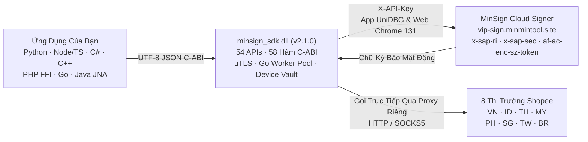

🌐 **Ngôn ngữ:** [English](README.md) | [Tiếng Việt](README.vi.md) | [Bahasa Indonesia](README.id.md) | [ภาษาไทย](README.th.md) | [简体中文](README.zh.md)

# ShopeeAPI — MinSign Native Universal SDK (`minsign_sdk.dll` v2.1.0)

[](./CHANGELOG.md)
[](./docs/QUICKSTART_BY_LANGUAGE.md)
[](#8-thị-trường-shopee-hỗ-trợ)
[](#kiến-trúc-ký-kép-app--web)
[](https://vip-sign.minmintool.site)

**Một file thư viện gốc Windows x64 C-ABI duy nhất (`minsign_sdk.dll`) — tích hợp trọn bộ 54 API Shopee, MCN & Shopee Affiliate chuẩn sản xuất, 7 Wrapper chính thức, 8 quốc gia Shopee và Hệ thống Ký Bảo Mật Kép (App Mobile UniDBG + Web Chrome 131).**

Không cần mở trình duyệt, không cần giả lập Android hay tự bảo trì thuật toán chống bot. Xây dựng ngay các hệ thống quét dữ liệu Shopee tốc độ cao, Bot săn Affiliate hoa hồng cao, quản lý MCN & duyệt lời mời tự động, công cụ Shopee Live & Shopee Video, hay tìm nguồn hàng bằng hình ảnh từ **Python, Node.js/TypeScript, C#, C++, PHP 8+ FFI, Go hoặc Java JNA** với tầng mạng `uTLS` gốc, kho thiết bị cố định `devices_vault.json` và Goroutine Worker Pool đa luồng ngay bên trong DLL.

> 📚 **Trung Tâm Tài Liệu:** [Đặc Tả JSON 54 API (EN)](./docs/API_REFERENCE.md) · [Quickstart 7 Ngôn Ngữ (EN)](./docs/QUICKSTART_BY_LANGUAGE.md) · [Kịch Bản Tự Động Hóa Thực Chiến (EN)](./docs/USE_CASES_AND_PLAYBOOKS.md) · [Lịch Sử Phiên Bản](./CHANGELOG.md) · [Cẩm Nang Kỹ Thuật Chi Tiết (Tiếng Việt)](./DOCS_MINSIGN_NATIVE_SDK.md)

---

## Kiến Trúc Ký Kép (App + Web)

Mọi kết nối tới Shopee (HTTP/WebSocket) đều đi **trực tiếp từ máy của bạn qua Proxy riêng** bằng vân tay mạng `uTLS` (Android OkHttp4 & Chrome 131). Máy chủ MinSign Cloud chỉ cấp phát chữ ký bảo mật động theo thời gian thực.



---

## Bạn Có Thể Xây Dựng Những Gì Với v2.1.0?

<table>
  <tr>
    <td width="50%" valign="top">
      <h3>1. Quét Dữ Liệu Sản Phẩm &amp; Giá Đa Luồng</h3>
      <ul>
        <li><strong>Quét Hàng Loạt Song Song (<code>batch_get_product_details</code>)</strong> — Goroutine Worker Pool xoay vòng Proxy &amp; Cookie, giữ nguyên thứ tự đầu vào.</li>
        <li><strong>Giải Mã Mọi Link Shopee (<code>resolve_shopee_url</code>)</strong> — Tự phân tích link sản phẩm, shop, video, live, link rút gọn (<code>shp.ee</code> / <code>s.shopee.*</code>) cho cả 8 quốc gia.</li>
        <li><strong>Đánh Giá, Flash Sale &amp; Gợi Ý</strong> — Lấy đánh giá kèm ảnh/video (<code>get_product_ratings</code>), khung Flash Sale, sản phẩm đề xuất và từ khóa gợi ý tìm kiếm.</li>
      </ul>
    </td>
    <td width="50%" valign="top">
      <h3>2. Hệ Thống Affiliate &amp; Săn Hoa Hồng Cao</h3>
      <ul>
        <li><strong>Săn Kèo Hoa Hồng Cao (<code>get_affiliate_offer_list</code>)</strong> — Truy vấn <code>affiliate.shopee.*</code> bằng Web Chrome 131 Signer lấy hoa hồng sàn, hoa hồng shop &amp; lượt bán tháng.</li>
        <li><strong>Báo Cáo Hoa Hồng (<code>get_affiliate_commission_report</code>)</strong> — Đồng bộ trực tiếp dữ liệu chuyển đổi &amp; doanh thu về Dashboard của bạn.</li>
        <li><strong>Đổi &amp; Rút Gọn Link Hàng Loạt (<code>batch_convert_affiliate_links</code>)</strong> — Chuyển link thường, link <code>aff_id</code> đối thủ sang link <code>s.shopee.*</code> gắn <code>subId1..5</code>.</li>
      </ul>
    </td>
  </tr>
  <tr>
    <td width="50%" valign="top">
      <h3>3. Shopee Video Studio &amp; Buff View Đa Luồng</h3>
      <ul>
        <li><strong>Đăng Video Thuần API 4 Bước (<code>upload_shopee_video</code>)</strong> — Gắn tối đa 6 sản phẩm giỏ hàng Affiliate, hỗ trợ Normal/Duet, đổi vân tay MP4 <code>MD5</code>/<code>SHA-256</code> trong <code>&lt;10ms</code> không cần FFmpeg.</li>
        <li><strong>Quét Video Shop Không Watermark (<code>get_shop_videos</code>)</strong> — Lấy sẵn link <code>mp4Url</code> sạch và danh sách SP gắn giỏ vàng.</li>
        <li><strong>Buff View Đa Luồng (<code>buff_video_batch</code>)</strong> — Đọc byte MP4 thật qua Proxy + bắn sự kiện <code>c-api-bit</code> tốc độ cao.</li>
      </ul>
    </td>
    <td width="50%" valign="top">
      <h3>4. Shopee Live Commerce &amp; Quét Giỏ Live</h3>
      <ul>
        <li><strong>Quét Sản Phẩm Giỏ Hàng Live (<code>get_live_bag_items</code>)</strong> — Trích xuất toàn bộ sản phẩm đang ghim trong giỏ cam, giá ưu đãi Live, tồn kho &amp; Affiliate.</li>
        <li><strong>Phân Tích Phòng Live (<code>get_live_session_detail</code>)</strong> — Lấy <code>sessionId</code>, <code>roomId</code>, mắt xem trực tiếp và link luồng FLV/HLS.</li>
        <li><strong>Kéo Mắt Xem Live Chuẩn WebSocket (<code>buff_live_batch</code>)</strong> — Kết nối RFC 6455 WS qua Proxy + Protobuf <code>HB_REQ</code> + <code>SZTracker</code>.</li>
      </ul>
    </td>
  </tr>
  <tr>
    <td width="50%" valign="top">
      <h3>5. Tìm Nguồn Hàng Bằng Hình Ảnh &amp; AI Crop</h3>
      <ul>
        <li><strong>Tìm Sản Phẩm Bằng Ảnh Thuần HTTP (<code>search_products_by_image</code>)</strong> — Hỗ trợ 5 nguồn ảnh (file nội bộ, Base64 Clipboard, link TikTok/1688/Taobao, CDN Shopee hoặc link SP).</li>
        <li><strong>Tìm Nguồn Rẻ Hơn (<code>CheaperOptions</code>)</strong> — Quét đối thủ bán rẻ hơn mà không cần trình duyệt hay giả lập.</li>
        <li><strong>Nhận Diện Khung Vật Thể AI (<code>get_image_bounding_box</code>)</strong> — Trả toạ độ vật thể trong ảnh chụp nhiều món đồ (<code>0</code> Cookie, <code>0</code> lượt ký).</li>
      </ul>
    </td>
    <td width="50%" valign="top">
      <h3>6. Ký Bảo Mật Kép App + Web &amp; Quản Lý Nick</h3>
      <ul>
        <li><strong>Web Chrome 131 Signer (<code>sign_web</code>)</strong> — Ký chuyên biệt cho các API Web/Affiliate/Seller với tham số <code>clientType: "web"</code>.</li>
        <li><strong>Layer-2 Risk Token &amp; Device Vault (<code>get_risk_token</code>)</strong> — Gắn cố định 1 máy Android 14/tài khoản trong <code>devices_vault.json</code> (mã hóa AES-256-GCM) + <code>af-ac-enc-sz-token</code>.</li>
        <li><strong>Check Cookie, Giỏ Hàng &amp; Lưu Voucher</strong> — Kiểm tra sống/chết Cookie (<code>get_account_profile</code>), xem giỏ hàng (<code>get_cart_summary</code>) và lưu Voucher (<code>claim_shop_voucher</code>).</li>
      </ul>
    </td>
  </tr>
</table>

---

## Lấy Mã `X-API-Key` Để Sử Dụng

1. Truy cập cổng dịch vụ chính thức: **[https://vip-sign.minmintool.site](https://vip-sign.minmintool.site)** (hỗ trợ Tiếng Việt, Tiếng Anh & Tiếng Thái).
2. Đăng ký hoặc đăng nhập nhanh bằng Google.
3. Nạp ví **Pay-As-You-Go** hoặc kích hoạt gói tháng (**Basic / Pro / VIP**) rồi sao chép **`X-API-Key`** tại mục **API Keys**.
4. Truyền `X-API-Key` vào `MinSignClient` và sử dụng trọn bộ 54 API ngay lập tức.

---

## Bắt Đầu Nhanh (7 Ngôn Ngữ)

> Xem hướng dẫn cài đặt chi tiết cho từng hệ sinh thái, lưu ý `x64` và quản lý bộ nhớ `MinSign_Free` tại [**`docs/QUICKSTART_BY_LANGUAGE.md`**](./docs/QUICKSTART_BY_LANGUAGE.md).

### Python 3.8+ (0 thư viện ngoài — Pure `ctypes`)

```python
from wrappers.python.minsign_sdk import MinSignClient

sdk = MinSignClient(api_key="YOUR_X_API_KEY", default_country="VN")

# 1. Giải mã mọi đường link Shopee (8 quốc gia)
resolved = sdk.resolve_shopee_url(url="https://shopee.co.th/product/1834601441/57811171288")
print(resolved["country"], resolved["shopId"], resolved["itemId"])

# 2. Quét hàng loạt sản phẩm song song ngay trong DLL
batch = sdk.batch_get_product_details(
    product_urls=[
        "https://shopee.vn/product/104187240/19894959672",
        "https://shopee.co.id/product/2955704/26112249802",
    ],
    proxies=["http://user:pass@ip:port"],
    concurrency=5,
)
print(f"Thành công: {batch['succeeded']}/{batch['total']} trong {batch['elapsedMs']}ms")

# 3. Săn sản phẩm Affiliate hoa hồng cao (Web Chrome 131 Signer)
offers = sdk.get_affiliate_offer_list(
    keyword="tai nghe bluetooth",
    sort_type=1,
    page_limit=10,
    cookie="SPC_U=...; SPC_ST=...;",
    country="VN",
)
print("Top Offer:", offers["items"][0]["name"], offers["items"][0]["commissionRate"])
```

### Node.js / TypeScript / Electron (`npm install koffi`)

```javascript
const { MinSignClient } = require("./wrappers/nodejs/minsign_sdk");

(async () => {
  const sdk = new MinSignClient({ apiKey: "YOUR_X_API_KEY", defaultCountry: "VN" });
  const ratings = await sdk.getProductRatings({
    productUrl: "https://shopee.vn/product/104187240/19894959672",
    limit: 20,
  });
  console.log("Đánh giá:", ratings.ratings?.length);
})();
```

### C# (.NET 6/8/9 & .NET Framework 4.7.2+ — `x64`)

```csharp
using var sdk = new MinSignClient(apiKey: "YOUR_X_API_KEY", defaultCountry: "VN");
var flashSale = sdk.GetFlashSaleItems(new { country = "VN", limit = 20 });
Console.WriteLine(flashSale.GetRawText());
```

### PHP 8.1+ (FFI), Go (Zero CGO), Java (JNA) & C++17
- **PHP FFI:** [`wrappers/php/MinSignSdk.php`](./wrappers/php/MinSignSdk.php) · [`examples/quickstart_php.php`](./examples/quickstart_php.php)
- **Go LazyDLL:** [`wrappers/go/minsign.go`](./wrappers/go/minsign.go) · [`examples/quickstart_go.go`](./examples/quickstart_go.go)
- **Java JNA:** [`wrappers/java/MinSignSdk.java`](./wrappers/java/MinSignSdk.java) · [`examples/QuickstartJava.java`](./examples/QuickstartJava.java)
- **C++17 RAII:** [`wrappers/cpp/minsign_sdk_client.hpp`](./wrappers/cpp/minsign_sdk_client.hpp) · [`examples/quickstart_cpp.cpp`](./examples/quickstart_cpp.cpp)

---

## Bảng Tra Cứu Toàn Bộ 54 API (`minsign_sdk.dll` v2.1.0)

> Ngoài **54 Action API** dưới đây, DLL còn xuất **4 hàm lõi C-ABI**: `MinSign_Init`, `MinSign_Version`, `MinSign_Invoke`, `MinSign_Free` (**tổng 58 hàm C-ABI**). Xem JSON đầu vào/đầu ra chi tiết tại [**`docs/API_REFERENCE.md`**](./docs/API_REFERENCE.md).

### 1. Hệ Thống, Kho Thiết Bị & Ký Kép App/Web (7 API)

| # | Action (`MinSign_Invoke`) | Hàm C-ABI | Chức Năng | Cần Cookie? | Phiên Bản |
|---|---|---|---|---|---|
| 1 | `check_api_key` | `MinSign_CheckApiKey` | Kiểm tra gói thuê, số dư ví, hạn mức ngày & tốc độ RPM | Không | `v1.0` |
| 2 | `bind_account_device` | `MinSign_BindAccountDevice` | Gắn cố định 1 hồ sơ Android 14 cho tài khoản trong `devices_vault.json` | Tuỳ chọn | `v1.0` |
| 3 | `list_local_devices` | `MinSign_ListLocalDevices` | Liệt kê danh sách `Tài khoản <-> Thiết bị` đang lưu cục bộ | Không | `v1.0` |
| 4 | `remove_local_device` | `MinSign_RemoveLocalDevice` | Xóa hồ sơ thiết bị cũ để cấp máy mới theo `accountKey` | Không | `v1.0` |
| 5 | `sign_raw` | `MinSign_SignRaw` | Xin chữ ký bảo mật động (hỗ trợ `clientType: "app"\|"web"` & `attachRiskHeaders`) | Tuỳ chọn | `v1.0` / `v2.0` |
| 6 | **`sign_web`** | **`MinSign_SignWeb`** | **Ký chuẩn trình duyệt Chrome 131 qua `/api/v1/web/sign` (trả Web headers + `patchedCookie`)** | Tuỳ chọn | **`v2.0`** |
| 7 | `get_risk_token` | `MinSign_GetRiskToken` | Sinh & lưu cache Layer-2 Risk Token (`af-ac-enc-sz-token`, `dfp`, `shpSecData`) | Tuỳ chọn | `v1.2` |

### 2. Sản Phẩm, Gian Hàng, Đánh Giá & Khám Phá (16 API)

| # | Action (`MinSign_Invoke`) | Hàm C-ABI | Chức Năng | Cần Cookie? | Phiên Bản |
|---|---|---|---|---|---|
| 8 | **`resolve_shopee_url`** | **`MinSign_ResolveShopeeUrl`** | **Phân tích link SP/Shop/Video/Live/link rút gọn (`shp.ee`, `s.shopee.*`) & chuẩn hóa URL 8 quốc gia** | Không | **`v2.0`** |
| 9 | `get_product_detail` | `MinSign_GetProductDetail` | Chi tiết sản phẩm đầy đủ (giá, tồn kho, đã bán, biến thể, ảnh HD, thông tin Shop) | Tuỳ chọn | `v1.0` |
| 10 | **`batch_get_product_details`** | **`MinSign_BatchGetProductDetails`** | **Quét đồng thời nhiều sản phẩm bằng Go Worker Pool xoay Proxy/Cookie giữ đúng thứ tự** | Tuỳ chọn | **`v2.0`** |
| 11 | **`get_product_ratings`** | **`MinSign_GetProductRatings`** | **Lấy đánh giá người mua phân trang, thống kê số sao & ảnh/video review** | Tuỳ chọn | **`v2.0`** |
| 12 | **`get_flash_sale_items`** | **`MinSign_GetFlashSaleItems`** | **Lấy các khung giờ Flash Sale đang chạy và danh sách sản phẩm giảm giá** | Tuỳ chọn | **`v2.0`** |
| 13 | **`get_recommend_products`** | **`MinSign_GetRecommendProducts`** | **Lấy danh sách Gợi ý hôm nay (`daily_discover_main`) hoặc Sản phẩm tương tự** | Tuỳ chọn | **`v2.0`** |
| 14 | **`get_search_suggestions`** | **`MinSign_GetSearchSuggestions`** | **Lấy từ khóa gợi ý tìm kiếm (autocomplete) trực tiếp từ Shopee** | Tuỳ chọn | **`v2.0`** |
| 15 | `search_products` | `MinSign_SearchProducts` | Tìm kiếm sản phẩm theo từ khóa (`relevancy`, `sales`, `ctime`, `price`) | Tuỳ chọn | `v1.0` |
| 16 | `search_products_by_image` | `MinSign_SearchProductsByImage` | Tìm sản phẩm bằng hình ảnh thuần HTTP (`SimilarProducts` / `CheaperOptions`) | **Có (`SPC_ST`)** | `v1.3` |
| 17 | `get_image_bounding_box` | `MinSign_GetImageBoundingBox` | AI nhận diện khung vật thể trong ảnh (`left,top,width,height` — `0` lượt ký) | Không | `v1.3` |
| 18 | `get_shop_overview` | `MinSign_GetShopOverview` | Hồ sơ gian hàng từ URL, `shopId` hoặc `username` (kèm Video `userId`) | Không | `v1.0` |
| 19 | `get_shop_products` | `MinSign_GetShopProducts` | Danh sách sản phẩm trong gian hàng phân trang (`limit`, `offset`) | Không | `v1.0` |
| 20 | `get_shop_newest_products` | `MinSign_GetShopNewestProducts` | Canh sản phẩm mới lên kệ thời gian thực (`sinceItemId`, `withinHours`, hoa hồng) | Tuỳ chọn | `v1.1` |
| 21 | `get_shop_categories` | `MinSign_GetShopCategories` | Danh mục con nội bộ của gian hàng | Không | `v1.0` |
| 22 | `get_shop_vouchers` | `MinSign_GetShopVouchers` | Quét toàn bộ mã giảm giá / Voucher đang mở của gian hàng | Không | `v1.0` |
| 23 | `get_category_tree` | `MinSign_GetCategoryTree` | Cây danh mục ngành hàng chính thức của Shopee theo quốc gia | Không | `v1.0` |

### 3. Tài Khoản, Giỏ Hàng & Lưu Voucher (3 API)

| # | Action (`MinSign_Invoke`) | Hàm C-ABI | Chức Năng | Cần Cookie? | Phiên Bản |
|---|---|---|---|---|---|
| 24 | **`get_account_profile`** | **`MinSign_GetAccountProfile`** | **Kiểm tra sống/chết Cookie (`alive`) & lấy `userId`, `shopId`, `username`, trạng thái Seller** | **Có** | **`v2.0`** |
| 25 | **`get_cart_summary`** | **`MinSign_GetCartSummary`** | **Xem giỏ hàng hiện tại (nhóm theo Shop, tổng số lượng, tạm tính)** | **Có** | **`v2.0`** |
| 26 | **`claim_shop_voucher`** | **`MinSign_ClaimShopVoucher`** | **Lưu mã giảm giá của Shop vào ví Voucher (tự động gắn Layer-2 Risk Headers)** | **Có** | **`v2.0`** |

### 4. Shopee Affiliate & Kiếm Tiền (5 API)

| # | Action (`MinSign_Invoke`) | Hàm C-ABI | Chức Năng | Cần Cookie? | Phiên Bản |
|---|---|---|---|---|---|
| 27 | **`get_affiliate_offer_list`** | **`MinSign_GetAffiliateOfferList`** | **Tìm sản phẩm Affiliate hoa hồng cao qua Web Chrome 131 Signer (`commissionRate`, `sales`)** | **Có** | **`v2.0`** |
| 28 | **`get_affiliate_commission_report`** | **`MinSign_GetAffiliateCommissionReport`** | **Truy vấn báo cáo đơn hàng & hoa hồng Affiliate theo mốc thời gian** | **Có** | **`v2.0`** |
| 29 | `get_affiliate_products` | `MinSign_GetAffiliateProducts` | Lấy danh sách sản phẩm Affiliate gợi ý gắn giỏ hàng Shopee Video | **Có** | `v1.0` |
| 30 | `convert_affiliate_link` | `MinSign_ConvertAffiliateLink` | Đổi & rút gọn mọi link Shopee sang link `s.shopee.*` gắn Cookie của bạn (`subId1..5`) | **Có** | `v1.5` |
| 31 | `batch_convert_affiliate_links` | `MinSign_BatchConvertAffiliateLinks` | Đổi hàng loạt nhiều link trong 1 lần gọi (tự chia chunk GraphQL `batchCustomLink`) | **Có** | `v1.5` |

### 5. Shopee Video Studio, Quét Kênh & Buff View (8 API)

| # | Action (`MinSign_Invoke`) | Hàm C-ABI | Chức Năng | Cần Cookie? | Phiên Bản |
|---|---|---|---|---|---|
| 32 | `upload_shopee_video` | `MinSign_UploadShopeeVideo` | Đăng Shopee Video thuần API 4 bước + gắn tối đa 6 SP Affiliate + Normal/Duet | **Có** | `v1.0` |
| 33 | `precheck_video_upload` | `MinSign_PrecheckVideoUpload` | Kiểm tra nhanh Cookie và quyền đăng Shopee Video | **Có** | `v1.0` |
| 34 | `mutate_mp4_fingerprint` | `MinSign_MutateMp4Fingerprint` | Đổi mã băm `MD5` & `SHA-256` file `.mp4` trong `<10ms` không cần FFmpeg | Không | `v1.0` |
| 35 | `buff_video_view` | `MinSign_BuffVideoView` | Đẩy 1 lượt xem Shopee Video chuẩn 4 bước qua Proxy | Tuỳ chọn | `v1.0` |
| 36 | `buff_video_batch` | `MinSign_BuffVideoBatch` | Buff view đa luồng bằng Go Worker Pool xoay vòng `proxies[]` & `cookies[]` | Tuỳ chọn | `v1.0` |
| 37 | `get_video_detail` | `MinSign_GetVideoDetail` | Thông số video (view, tim, bình luận, link tải `mp4Url` không watermark) | Tuỳ chọn | `v1.0` |
| 38 | `get_shop_videos` | `MinSign_GetShopVideos` | Quét toàn bộ video của Shop kèm `mp4Url` gốc & `attachedProducts[]` | Khuyên dùng | `v1.1` |
| 39 | `get_channel_and_hashtag_videos` | `MinSign_GetChannelAndHashtagVideos` | Quét video theo kênh `requestUserId` hoặc theo `hashtagId` | Tuỳ chọn | `v1.0` |

### 6. Shopee Live Commerce & Kéo Mắt Xem (4 API)

| # | Action (`MinSign_Invoke`) | Hàm C-ABI | Chức Năng | Cần Cookie? | Phiên Bản |
|---|---|---|---|---|---|
| 40 | `get_live_session_detail` | `MinSign_GetLiveSessionDetail` | Giải link Live / `sessionId` → `roomId`, `viewerCount`, `usersig`, `playUrls` | Tuỳ chọn | `v1.4` |
| 41 | **`get_live_bag_items`** | **`MinSign_GetLiveBagItems`** | **Quét sản phẩm đang ghim trong giỏ hàng Live (giá Live, giảm giá, tồn kho, Affiliate)** | Tuỳ chọn | **`v2.0`** |
| 42 | `buff_live_view` | `MinSign_BuffLiveView` | 1 phiên xem Live trọn vẹn (`joinv2` → FLV/HLS → WS `HB_REQ` → `reportPB` → `/exit`) | Tuỳ chọn | `v1.4` |
| 43 | `buff_live_batch` | `MinSign_BuffLiveBatch` | Kéo mắt Live đa luồng xoay `proxies[]` & `cookies[]` có `staggerMs` | Tuỳ chọn | `v1.4` |

### 7. Cổng Ký HTTP Vạn Năng (1 API)

| # | Action (`MinSign_Invoke`) | Hàm C-ABI | Chức Năng | Cần Cookie? | Phiên Bản |
|---|---|---|---|---|---|
| 44 | `execute_signed_request` | `MinSign_ExecuteSignedRequest` | Ký & gọi **mọi** API GET/POST của Shopee qua `uTLS` + Proxy (`clientType: "app"\|"web"` & `attachRiskHeaders`) | Tuỳ chọn | `v1.0` / `v2.0` |

### 8. Shopee MCN, Duyệt Lời Mời (`acp`) & Trung Tâm Affiliate (10 API — *MỚI trong v2.1*)

| # | Action (`MinSign_Invoke`) | Hàm C-ABI | Chức Năng | Cần Cookie? | Phiên Bản |
|---|---|---|---|---|---|
| 45 | **`get_affiliate_user_profile`** | **`MinSign_GetAffiliateUserProfile`** | **Lấy hồ sơ Affiliate, `affiliateId`, trạng thái Thanh toán/Thuế & cờ `isAllowMcnSetAds`** | **Có** | **`v2.1`** |
| 46 | **`get_mcn_partnership_status`** | **`MinSign_GetMcnPartnershipStatus`** | **Quét trạng thái hợp tác MCN hiện tại & danh sách lời mời MCN (GraphQL + fallback REST)** | **Có** | **`v2.1`** |
| 47 | **`reply_mcn_invitation`** (`acp_mcn_invitation`) | **`MinSign_ReplyMcnInvitation`** | **Chấp nhận (`accept`) hoặc từ chối (`reject`) lời mời / yêu cầu MCN (`mcnKOLReplyToMCNRequest`)** | **Có** | **`v2.1`** |
| 48 | **`get_mcn_kol_partnerships`** | **`MinSign_GetMcnKolPartnerships`** | **Lấy danh sách hợp tác KOL/Affiliate trên Cổng MCN (`mcn.affiliate.shopee.*`)** | **Có** | **`v2.1`** |
| 49 | **`send_mcn_partnership_invitation`** | **`MinSign_SendMcnPartnershipInvitation`** | **Kiểm tra username/affiliateId và gửi lời mời hợp tác từ Cổng MCN tới KOL** | **Có** | **`v2.1`** |
| 50 | **`manage_mcn_partnership`** | **`MinSign_ManageMcnPartnership`** | **Thao tác hợp đồng phía MCN (`reply`\|`accept`\|`reject`\|`change_fee`\|`extend`\|`cancel`\|`history`)** | **Có** | **`v2.1`** |
| 51 | **`get_mcn_analytics`** | **`MinSign_GetMcnAnalytics`** | **Thống kê doanh thu/đơn MCN, chỉ số KOL, chiến dịch MCN & thông tin MCN** | **Có** | **`v2.1`** |
| 52 | **`get_affiliate_payment_tax`** | **`MinSign_GetAffiliatePaymentTax`** | **Kiểm tra trạng thái Ngân hàng, Thuế TIN/CCCD & thuế suất EWT/VAT** | **Có** | **`v2.1`** |
| 53 | **`get_affiliate_click_report`** | **`MinSign_GetAffiliateClickReport`** | **Lấy báo cáo lượt Click Affiliate (`/api/v1/click_report/list`)** | **Có** | **`v2.1`** |
| 54 | **`get_affiliate_billing`** | **`MinSign_GetAffiliateBilling`** | **Đối soát hóa đơn thanh toán Affiliate & chi tiết khấu trừ phí MCN** | **Có** | **`v2.1`** |

---

## 8 Thị Trường Shopee Hỗ Trợ

| Mã | Quốc Gia | Tên Miền | Tiền Tệ |
|---|---|---|---|
| `VN` | Việt Nam | `shopee.vn` | VND (`₫`) |
| `ID` | Indonesia | `shopee.co.id` | IDR (`Rp`) |
| `TH` | Thái Lan | `shopee.co.th` | THB (`฿`) |
| `MY` | Malaysia | `shopee.com.my` | MYR (`RM`) |
| `PH` | Philippines | `shopee.ph` | PHP (`₱`) |
| `SG` | Singapore | `shopee.sg` | SGD (`S$`) |
| `TW` | Đài Loan | `shopee.tw` | TWD (`NT$`) |
| `BR` | Brazil | `shopee.com.br` | BRL (`R$`) |

---

## Điều Khoản Sử Dụng
Xem chi tiết tại [`TERMS_OF_SERVICE.md`](./TERMS_OF_SERVICE.md) và [`LICENSE`](./LICENSE). Bộ SDK được cung cấp theo nguyên tắc **AS-IS** phục vụ nghiên cứu giao thức, kiểm thử Sandbox và tự động hóa hợp pháp.
