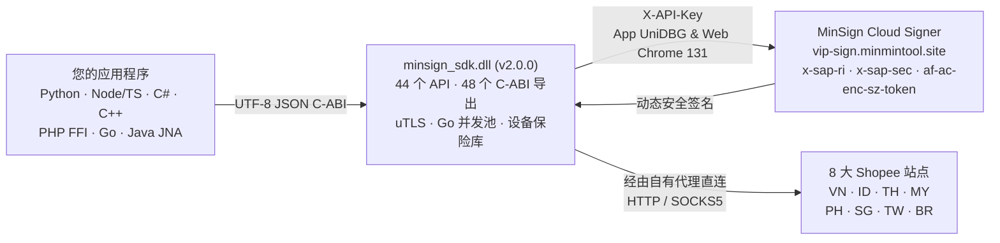

🌐 **语言:** [English](README.md) | [Tiếng Việt](README.vi.md) | [Bahasa Indonesia](README.id.md) | [ภาษาไทย](README.th.md) | [简体中文](README.zh.md)

# ShopeeAPI — MinSign Native Universal SDK (`minsign_sdk.dll` v2.0.0)

[](./CHANGELOG.md)
[](./docs/QUICKSTART_BY_LANGUAGE.md)
[](#支持的-8-大-shopee-站点)
[](#双模式签名架构)
[](https://vip-sign.minmintool.site)

**单文件 Windows x64 原生 C-ABI 核心库（`minsign_sdk.dll`）——内置 44 个生产级 Shopee 与 Shopee Affiliate 接口、7 种主流编程语言官方封装、覆盖 8 大 Shopee 站点，并支持 App Mobile UniDBG + Web Chrome 131 双模式安全签名。**

彻底告别无头浏览器、安卓模拟器与脆弱的逆向脚本。通过单一零依赖 DLL，即可在 **Python、Node.js/TypeScript、C#、C++、PHP 8+ FFI、Go 或 Java JNA** 中直接构建高并发 Shopee 商品采集器、高佣联盟选品机器人、直播间小黄车抓取、以图搜货及 Shopee Video 自动化系统。内置原生 `uTLS` 指纹栈、账号专属安卓设备保险库（`devices_vault.json`）以及 Go 并发协程池。

> 📚 **文档中心：** [44 个 API 完整 JSON 规范 (EN)](./docs/API_REFERENCE.md) · [7 种语言快速上手 (EN)](./docs/QUICKSTART_BY_LANGUAGE.md) · [5 大实战自动化方案 (EN)](./docs/USE_CASES_AND_PLAYBOOKS.md) · [版本更新日志](./CHANGELOG.md)

---

## 双模式签名架构

所有面向 Shopee 的 HTTP/WebSocket 业务流量均**直接从您的本地服务器经由自有代理发出**（使用原生 `uTLS` 模拟 Android OkHttp4 与 Chrome 131 TLS 指纹），MinSign Cloud 仅实时提供动态安全签名头。



---

## v2.0.0 核心能力矩阵

<table>
  <tr>
    <td width="50%" valign="top">
      <h3>1. 商品情报与高并发批量采集</h3>
      <ul>
        <li><strong>多线程批量抓取 (<code>batch_get_product_details</code>)</strong> — DLL 内置 Go 协程池，自动轮换代理与 Cookie，严格保持输入顺序。</li>
        <li><strong>全能链接解析器 (<code>resolve_shopee_url</code>)</strong> — 自动识别商品、店铺、视频、直播及短链（<code>shp.ee</code> / <code>s.shopee.*</code>），覆盖 8 大站点。</li>
        <li><strong>评价、秒杀与推荐流</strong> — 采集买家带图/视频评价（<code>get_product_ratings</code>）、Flash Sale 秒杀场次、每日推荐及搜索下拉热词。</li>
      </ul>
    </td>
    <td width="50%" valign="top">
      <h3>2. 联盟营销（Affiliate）与选品变现</h3>
      <ul>
        <li><strong>高佣选品库检索 (<code>get_affiliate_offer_list</code>)</strong> — 通过 Web Chrome 131 签名直连 <code>affiliate.shopee.*</code>，获取平台佣金与商家额外佣金及月销量。</li>
        <li><strong>佣金转化报表 (<code>get_affiliate_commission_report</code>)</strong> — 按时间区间自动拉取联盟订单与佣金明细，接入您的 BI 看板。</li>
        <li><strong>批量联盟转链 (<code>batch_convert_affiliate_links</code>)</strong> — 将普通商品链或竞品 <code>aff_id</code> 链接批量转为归属您账号的 <code>s.shopee.*</code> 短链（支持 <code>subId1..5</code>）。</li>
      </ul>
    </td>
  </tr>
  <tr>
    <td width="50%" valign="top">
      <h3>3. Shopee Video 视频工作室与播放引擎</h3>
      <ul>
        <li><strong>纯 API 四步发布视频 (<code>upload_shopee_video</code>)</strong> — 最多挂载 6 个联盟小黄车商品，支持普通/合拍模式，内置无需 FFmpeg 的 <code>&lt;10ms</code> MP4 二进制去重（刷新 <code>MD5</code>/<code>SHA-256</code>）。</li>
        <li><strong>店铺无水印视频采集 (<code>get_shop_videos</code>)</strong> — 导出无水印原片 <code>mp4Url</code> 及挂载商品列表（<code>attachedProducts[]</code>）。</li>
        <li><strong>高并发视频播放池 (<code>buff_video_batch</code>)</strong> — 真实 MP4 分片拉流 + <code>c-api-bit</code> 埋点上报。</li>
      </ul>
    </td>
    <td width="50%" valign="top">
      <h3>4. Shopee Live 直播带货与购物袋采集</h3>
      <ul>
        <li><strong>直播间小黄车采集 (<code>get_live_bag_items</code>)</strong> — 抓取直播购物袋置顶商品、直播专属价、折扣、库存与联盟信息。</li>
        <li><strong>直播间状态分析 (<code>get_live_session_detail</code>)</strong> — 解析直播链接获取 <code>sessionId</code>、<code>roomId</code>、实时在线人数及 FLV/HLS 拉流地址。</li>
        <li><strong>WebSocket + Protobuf 观众引擎 (<code>buff_live_batch</code>)</strong> — 代理隧道 RFC 6455 WS、<code>HB_REQ</code> 心跳与 <code>SZTracker</code> 上报。</li>
      </ul>
    </td>
  </tr>
  <tr>
    <td width="50%" valign="top">
      <h3>5. AI 以图搜货与低价找源</h3>
      <ul>
        <li><strong>纯 HTTP 以图搜款 (<code>search_products_by_image</code>)</strong> — 支持 5 种图片来源（本地文件、剪贴板 Base64、TikTok/1688/淘宝外链、Shopee CDN 或商品链接）。</li>
        <li><strong>同款低价找源 (<code>CheaperOptions</code>)</strong> — 零浏览器开销一键比价找更低价货源。</li>
        <li><strong>AI 物体框选检测 (<code>get_image_bounding_box</code>)</strong> — 自动识别多商品图中的主体坐标（<code>0</code> Cookie、<code>0</code> 签名积分）。</li>
      </ul>
    </td>
    <td width="50%" valign="top">
      <h3>6. App + Web 双模签名与账号管理</h3>
      <ul>
        <li><strong>Web Chrome 131 签名器 (<code>sign_web</code>)</strong> — 专为网页端、联盟后台与卖家接口提供 <code>clientType: "web"</code> 签名。</li>
        <li><strong>Layer-2 风控令牌与设备库 (<code>get_risk_token</code>)</strong> — 为每个账号在 <code>devices_vault.json</code> 绑定固定 Android 14 硬件环境（可选 AES-256-GCM 加密）并签发 <code>af-ac-enc-sz-token</code>。</li>
        <li><strong>验活、购物车与领券</strong> — 检测 Cookie 存活（<code>get_account_profile</code>）、读取购物车（<code>get_cart_summary</code>）及自动领取店铺券（<code>claim_shop_voucher</code>）。</li>
      </ul>
    </td>
  </tr>
</table>

---

## 获取 `X-API-Key`

1. 访问官方控制台：**[https://vip-sign.minmintool.site](https://vip-sign.minmintool.site)**（支持英文、越南语及泰语）。
2. 注册账号或使用 Google 一键登录。
3. 充值 **按量计费（Pay-As-You-Go）** 或开通月度套餐（**Basic / Pro / VIP**），在 **API Keys** 页面复制您的 **`X-API-Key`**。
4. 将 `X-API-Key` 传入 `MinSignClient`，即可立即调用全部 44 个接口。

---

## 快速开始（7 种编程语言）

> 完整环境配置、`x64` 架构说明与 `MinSign_Free` 内存释放规范请阅读 [**`docs/QUICKSTART_BY_LANGUAGE.md`**](./docs/QUICKSTART_BY_LANGUAGE.md)。

### Python 3.8+（零第三方依赖 — 纯 `ctypes`）

```python
from wrappers.python.minsign_sdk import MinSignClient

sdk = MinSignClient(api_key="YOUR_X_API_KEY", default_country="TW")

# 1. 解析任意 Shopee 站点链接（支持 8 国）
resolved = sdk.resolve_shopee_url(url="https://shopee.co.th/product/1834601441/57811171288")
print(resolved["country"], resolved["shopId"], resolved["itemId"])

# 2. DLL 内置协程池并发抓取多个商品详情
batch = sdk.batch_get_product_details(
    product_urls=[
        "https://shopee.co.id/product/2955704/26112249802",
        "https://shopee.co.th/product/1834601441/57811171288",
    ],
    proxies=["http://user:pass@ip:port"],
    concurrency=5,
)
print(f"成功: {batch['succeeded']}/{batch['total']} 耗时 {batch['elapsedMs']}ms")

# 3. 检索高佣联盟商品（Web Chrome 131 签名）
offers = sdk.get_affiliate_offer_list(
    keyword="无线耳机",
    sort_type=1,
    page_limit=10,
    cookie="SPC_U=...; SPC_ST=...;",
    country="TW",
)
print("高佣商品:", offers["items"][0]["name"], offers["items"][0]["commissionRate"])
```

### Node.js / TypeScript (`npm install koffi`)

```javascript
const { MinSignClient } = require("./wrappers/nodejs/minsign_sdk");

(async () => {
  const sdk = new MinSignClient({ apiKey: "YOUR_X_API_KEY", defaultCountry: "SG" });
  const suggestions = await sdk.getSearchSuggestions({ keyword: "keyboard", limit: 10, country: "SG" });
  console.log("搜索热词:", suggestions.suggestions);
})();
```

### C#（.NET 6/8/9 & .NET Framework 4.7.2+ — `x64`）

```csharp
using var sdk = new MinSignClient(apiKey: "YOUR_X_API_KEY", defaultCountry: "TW");
var flashSale = sdk.GetFlashSaleItems(new { country = "TW", limit = 20 });
Console.WriteLine(flashSale.GetRawText());
```

### PHP 8.1+ (FFI)、Go (零 CGO)、Java (JNA) 与 C++17
- **PHP FFI:** [`wrappers/php/MinSignSdk.php`](./wrappers/php/MinSignSdk.php) · [`examples/quickstart_php.php`](./examples/quickstart_php.php)
- **Go LazyDLL:** [`wrappers/go/minsign.go`](./wrappers/go/minsign.go) · [`examples/quickstart_go.go`](./examples/quickstart_go.go)
- **Java JNA:** [`wrappers/java/MinSignSdk.java`](./wrappers/java/MinSignSdk.java) · [`examples/QuickstartJava.java`](./examples/QuickstartJava.java)
- **C++17 RAII:** [`wrappers/cpp/minsign_sdk_client.hpp`](./wrappers/cpp/minsign_sdk_client.hpp) · [`examples/quickstart_cpp.cpp`](./examples/quickstart_cpp.cpp)

---

## 全部 44 个 API 索引总览（`minsign_sdk.dll` v2.0.0）

> 除下列 **44 个业务 Action API** 外，DLL 还导出 **4 个核心生命周期/分发函数**：`MinSign_Init`、`MinSign_Version`、`MinSign_Invoke`、`MinSign_Free`（**共 48 个 C-ABI 导出符号**）。详细请求与响应字段请参阅 [**`docs/API_REFERENCE.md`**](./docs/API_REFERENCE.md)。

### 1. 系统、设备库与双模签名（7 个 API）

| # | Action (`MinSign_Invoke`) | C-ABI 导出名 | 功能说明 | 需 Cookie? | 版本 |
|---|---|---|---|---|---|
| 1 | `check_api_key` | `MinSign_CheckApiKey` | 查询套餐类型、钱包余额、每日额度及 RPM 限制 | 否 | `v1.0` |
| 2 | `bind_account_device` | `MinSign_BindAccountDevice` | 为账号在 `devices_vault.json` 中持久化绑定固定 Android 14 设备 | 可选 | `v1.0` |
| 3 | `list_local_devices` | `MinSign_ListLocalDevices` | 列出本地保存的所有 `账号 <-> 设备` 映射 | 否 | `v1.0` |
| 4 | `remove_local_device` | `MinSign_RemoveLocalDevice` | 按 `accountKey` 解绑并清除旧设备配置 | 否 | `v1.0` |
| 5 | `sign_raw` | `MinSign_SignRaw` | 获取动态安全签名头（支持 `clientType: "app"\|"web"` 与 `attachRiskHeaders`） | 可选 | `v1.0` / `v2.0` |
| 6 | **`sign_web`** | **`MinSign_SignWeb`** | **调用 `/api/v1/web/sign` 生成 Chrome 131 Web 签名头与 `patchedCookie`** | 可选 | **`v2.0`** |
| 7 | `get_risk_token` | `MinSign_GetRiskToken` | 签发并缓存 Layer-2 风控令牌（`af-ac-enc-sz-token`、`dfp`、`shpSecData`） | 可选 | `v1.2` |

### 2. 商品、店铺、评价与发现（16 个 API）

| # | Action (`MinSign_Invoke`) | C-ABI 导出名 | 功能说明 | 需 Cookie? | 版本 |
|---|---|---|---|---|---|
| 8 | **`resolve_shopee_url`** | **`MinSign_ResolveShopeeUrl`** | **解析商品/店铺/视频/直播/短链（`shp.ee`、`s.shopee.*`）并生成 8 国标准链接** | 否 | **`v2.0`** |
| 9 | `get_product_detail` | `MinSign_GetProductDetail` | 获取商品完整详情（标题、价格、库存、销量、SKU 规格、高清图、店铺信息） | 可选 | `v1.0` |
| 10 | **`batch_get_product_details`** | **`MinSign_BatchGetProductDetails`** | **Go 协程池并发批量抓取商品详情，自动轮换代理/Cookie 并保序返回** | 可选 | **`v2.0`** |
| 11 | **`get_product_ratings`** | **`MinSign_GetProductRatings`** | **分页采集买家评价、各星级统计汇总及评价晒图/视频链接** | 可选 | **`v2.0`** |
| 12 | **`get_flash_sale_items`** | **`MinSign_GetFlashSaleItems`** | **获取当前站点 Flash Sale 秒杀场次及折扣商品列表** | 可选 | **`v2.0`** |
| 13 | **`get_recommend_products`** | **`MinSign_GetRecommendProducts`** | **获取每日推荐（`daily_discover_main`）或相似商品推荐流** | 可选 | **`v2.0`** |
| 14 | **`get_search_suggestions`** | **`MinSign_GetSearchSuggestions`** | **获取 Shopee 实时搜索联想词与热词提示** | 可选 | **`v2.0`** |
| 15 | `search_products` | `MinSign_SearchProducts` | 关键词搜索商品（支持 `relevancy`、`sales`、`ctime`、`price` 排序） | 可选 | `v1.0` |
| 16 | `search_products_by_image` | `MinSign_SearchProductsByImage` | 纯 HTTP 以图搜货（`SimilarProducts` / `CheaperOptions`） | **是 (`SPC_ST`)** | `v1.3` |
| 17 | `get_image_bounding_box` | `MinSign_GetImageBoundingBox` | AI 识别图片中的商品主体坐标（`left,top,width,height`，`0` 积分消耗） | 否 | `v1.3` |
| 18 | `get_shop_overview` | `MinSign_GetShopOverview` | 通过链接、`shopId` 或 `username` 获取店铺主页概况（含视频 `userId`） | 否 | `v1.0` |
| 19 | `get_shop_products` | `MinSign_GetShopProducts` | 分页获取店铺在售商品列表（`limit`、`offset`） | 否 | `v1.0` |
| 20 | `get_shop_newest_products` | `MinSign_GetShopNewestProducts` | 实时监控店铺最新上架商品（支持 `sinceItemId`、`withinHours` 增量过滤） | 可选 | `v1.1` |
| 21 | `get_shop_categories` | `MinSign_GetShopCategories` | 获取店铺自定义分类 | 否 | `v1.0` |
| 22 | `get_shop_vouchers` | `MinSign_GetShopVouchers` | 采集店铺当前可领取的全部优惠券 | 否 | `v1.0` |
| 23 | `get_category_tree` | `MinSign_GetCategoryTree` | 获取各站点官方完整类目树 | 否 | `v1.0` |

### 3. 账号、购物车与领券（3 个 API）

| # | Action (`MinSign_Invoke`) | C-ABI 导出名 | 功能说明 | 需 Cookie? | 版本 |
|---|---|---|---|---|---|
| 24 | **`get_account_profile`** | **`MinSign_GetAccountProfile`** | **检测 Cookie 存活（`alive`）并获取 `userId`、`shopId`、`username` 及卖家标识** | **是** | **`v2.0`** |
| 25 | **`get_cart_summary`** | **`MinSign_GetCartSummary`** | **读取当前账号购物车分组商品、件数与小计** | **是** | **`v2.0`** |
| 26 | **`claim_shop_voucher`** | **`MinSign_ClaimShopVoucher`** | **自动附带 Layer-2 风控头领取店铺优惠券** | **是** | **`v2.0`** |

### 4. Shopee Affiliate 联盟营销（5 个 API）

| # | Action (`MinSign_Invoke`) | C-ABI 导出名 | 功能说明 | 需 Cookie? | 版本 |
|---|---|---|---|---|---|
| 27 | **`get_affiliate_offer_list`** | **`MinSign_GetAffiliateOfferList`** | **使用 Web Chrome 131 签名检索高佣商品列表（`commissionRate`、`sales`）** | **是** | **`v2.0`** |
| 28 | **`get_affiliate_commission_report`** | **`MinSign_GetAffiliateCommissionReport`** | **按时间范围查询联盟订单转化与佣金结算报表** | **是** | **`v2.0`** |
| 29 | `get_affiliate_products` | `MinSign_GetAffiliateProducts` | 获取适配 Shopee Video 挂载的推荐联盟商品 | **是** | `v1.0` |
| 30 | `convert_affiliate_link` | `MinSign_ConvertAffiliateLink` | 将任意 Shopee 链接转为归属您的 `s.shopee.*` 推广短链（支持 `subId1..5`） | **是** | `v1.5` |
| 31 | `batch_convert_affiliate_links` | `MinSign_BatchConvertAffiliateLinks` | 通过 GraphQL 自动分片批量转换并缩短多条推广链接 | **是** | `v1.5` |

### 5. Shopee Video 视频发布、采集与播放（8 个 API）

| # | Action (`MinSign_Invoke`) | C-ABI 导出名 | 功能说明 | 需 Cookie? | 版本 |
|---|---|---|---|---|---|
| 32 | `upload_shopee_video` | `MinSign_UploadShopeeVideo` | 纯 API 四步发布视频 + 最多 6 个联盟商品 + 普通/合拍模式 | **是** | `v1.0` |
| 33 | `precheck_video_upload` | `MinSign_PrecheckVideoUpload` | 预检账号 Cookie 状态与视频发布权限 | **是** | `v1.0` |
| 34 | `mutate_mp4_fingerprint` | `MinSign_MutateMp4Fingerprint` | 无需 FFmpeg，`<10ms` 内刷新 `.mp4` 文件的 `MD5` 与 `SHA-256` 哈希 | 否 | `v1.0` |
| 35 | `buff_video_view` | `MinSign_BuffVideoView` | 经由代理执行单次完整四步 Shopee Video 播放上报 | 可选 | `v1.0` |
| 36 | `buff_video_batch` | `MinSign_BuffVideoBatch` | Go 并发池自动轮换 `proxies[]` 与 `cookies[]` 批量执行播放 | 可选 | `v1.0` |
| 37 | `get_video_detail` | `MinSign_GetVideoDetail` | 获取视频播放、点赞、评论数与无水印 `mp4Url` | 可选 | `v1.0` |
| 38 | `get_shop_videos` | `MinSign_GetShopVideos` | 抓取店铺全部视频及无水印 `mp4Url` 与 `attachedProducts[]` | 建议 | `v1.1` |
| 39 | `get_channel_and_hashtag_videos` | `MinSign_GetChannelAndHashtagVideos` | 按频道 `requestUserId` 或话题 `hashtagId` 采集视频列表 | 可选 | `v1.0` |

### 6. Shopee Live 直播带货与观众引擎（4 个 API）

| # | Action (`MinSign_Invoke`) | C-ABI 导出名 | 功能说明 | 需 Cookie? | 版本 |
|---|---|---|---|---|---|
| 40 | `get_live_session_detail` | `MinSign_GetLiveSessionDetail` | 解析直播链接 / `sessionId` → `roomId`、`viewerCount`、`usersig`、`playUrls` | 可选 | `v1.4` |
| 41 | **`get_live_bag_items`** | **`MinSign_GetLiveBagItems`** | **抓取直播间购物袋挂载商品（直播价、折扣、库存与联盟信息）** | 可选 | **`v2.0`** |
| 42 | `buff_live_view` | `MinSign_BuffLiveView` | 单路完整直播观看流程（`joinv2` → FLV/HLS → WS `HB_REQ` → `reportPB` → `/exit`） | 可选 | `v1.4` |
| 43 | `buff_live_batch` | `MinSign_BuffLiveBatch` | 多线程直播观众池，支持代理/Cookie 轮换与错峰入场 | 可选 | `v1.4` |

### 7. 通用签名 HTTP 网关（1 个 API）

| # | Action (`MinSign_Invoke`) | C-ABI 导出名 | 功能说明 | 需 Cookie? | 版本 |
|---|---|---|---|---|---|
| 44 | `execute_signed_request` | `MinSign_ExecuteSignedRequest` | 通过 `uTLS` + 代理签名并调用**任意 Shopee GET/POST 接口**（支持 `clientType: "app"\|"web"` 及 `attachRiskHeaders`） | 可选 | `v1.0` / `v2.0` |

---

## 支持的 8 大 Shopee 站点

| 代码 | 国家 / 地区 | 域名 | 货币 |
|---|---|---|---|
| `VN` | 越南 | `shopee.vn` | VND (`₫`) |
| `ID` | 印度尼西亚 | `shopee.co.id` | IDR (`Rp`) |
| `TH` | 泰国 | `shopee.co.th` | THB (`฿`) |
| `MY` | 马来西亚 | `shopee.com.my` | MYR (`RM`) |
| `PH` | 菲律宾 | `shopee.ph` | PHP (`₱`) |
| `SG` | 新加坡 | `shopee.sg` | SGD (`S$`) |
| `TW` | 中国台湾 | `shopee.tw` | TWD (`NT$`) |
| `BR` | 巴西 | `shopee.com.br` | BRL (`R$`) |

---

## 服务条款与许可
详见 [`TERMS_OF_SERVICE.md`](./TERMS_OF_SERVICE.md) 与 [`LICENSE`](./LICENSE)。本 SDK 按 **AS-IS（现状）** 提供，仅供协议研究、沙箱测试及获得授权的内部自动化使用。
